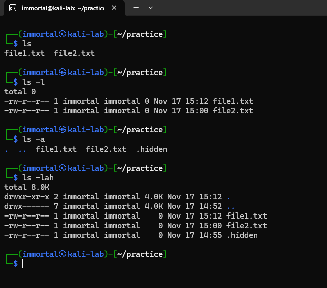
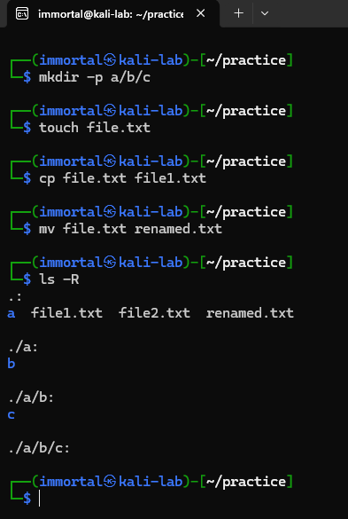
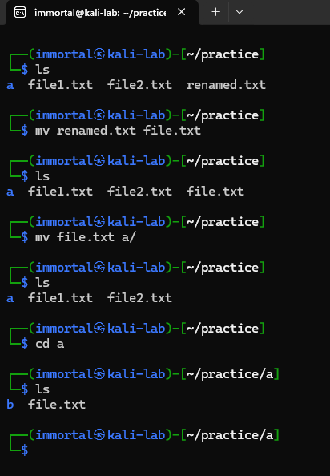
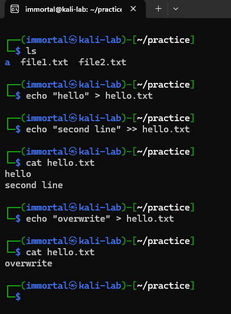
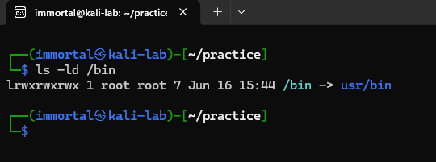
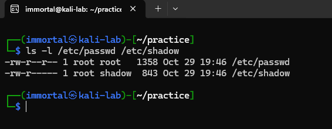
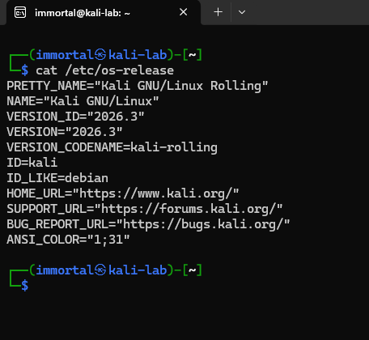

# Linux Notes: Basics and Files

[Back to Linux index](README.md)

## Setup: practice environment

What I need (all free):

- VirtualBox or VMware Workstation Player
- Kali Linux VM (my attacker machine)
- Ubuntu Server or Desktop VM (my practice target; also used to practice SSH)
- Or WSL, to install Kali and Ubuntu inside Windows (easy setup, good for practicing commands)

I practiced the commands in this file on Kali Linux running in WSL2.

Book: *The Linux Command Line* by William Shotts (free PDF at linuxcommand.org).

**Network setting (VirtualBox VMs):** set both VMs to the same Host-only Adapter (or NAT Network) so they can reach each other. Take a snapshot of each VM before starting, so I can undo mistakes. WSL has no snapshots, so I can back it up with `wsl --export` instead.

Create a safe practice directory (in Kali or Ubuntu):

```bash
mkdir ~/practice  # create a practice directory
cd ~/practice     # do all the exercises inside this directory so I do not break anything
```

The **man pages** (manual pages) are the built-in Linux documentation that explains how to use commands. I type `man ls` and press `q` to quit.

## Getting help and flags (switches)

Most commands accept flags that change their behavior. A flag usually starts with `-` (short option) or `--` (long option).

First I created a few files to list:

```bash
touch file1.txt file2.txt .hidden
echo "hello" > file.txt
```

Then I ran `ls` with different flags:

```bash
ls         # list files
ls -l      # long format (permissions, owner, size, date)
ls -a      # show hidden files (names starting with .)
ls -lah    # combine flags: long, all, human-readable sizes
ls --help  # quick help
man ls     # full manual (press q to quit)
```



- `ls -a` revealed `.hidden`, so plain `ls` really does hide files that start with a dot.
- In `ls -l`, `-rw-r--r--` means a regular file where the owner can read and write, and the group and others can only read.
- `total 4` in `ls -l` is the disk space used by the files, counted in blocks, and not the number of files. It is easy to misread.
- `file.txt` is 6 bytes because `echo "hello"` writes the 5 letters plus a newline character.

## Important terminology

- **Filesystem:** The overall structure used by Linux to organize and manage files and directories.
- **Directory:** A location in the filesystem used to organize files and other directories. Commonly called a folder.
- **File:** A filesystem object used to store data, such as text, code, images, or other information.

## Navigating and managing files

These are separate examples, not one sequence. File names like `renamed.txt` and `file.txt` are just example names.

```bash
pwd                       # print current directory
cd /etc                   # go to an absolute path
cd ..                     # go up one level
cd ~                      # go to your home directory
cd -                      # go back to the previous directory

mkdir notes               # create a directory
mkdir -p a/b/c            # create nested directories in one go
touch file1.txt           # create an empty file
cp file1.txt file2.txt    # copy a file
cp -r a/ backup/          # copy a directory
mv renamed.txt file.txt   # rename a file
mv file.txt a/            # move a file into a directory
rm renamed.txt            # delete a file (no recycle bin!)
rm -r backup/             # delete a directory and its contents
rm -rf backup/            # forcefully delete a directory and its contents
rmdir notes               # delete an empty directory
ls -R                     # list a directory and everything inside it, recursively
```



*Note: `file2.txt` in the output was already in this directory from an earlier exercise. It was not created by these commands.*

- `.` is the current directory, and each `./a` or `./a/b` heading shows the path of the directory listed under it.
- `mkdir -p` created all three levels with one command. Without `-p`, `mkdir a/b/c` would fail because `a` and `a/b` don't exist yet.
- `cp file1.txt file2.txt` copies `file1.txt` to `file2.txt`. If `file2.txt` exists it is overwritten, and if it doesn't exist it is created and then filled with the copy.



- `mv renamed.txt file.txt`: both names are in the same directory, so Linux renames `renamed.txt` to `file.txt`.
- `mv file.txt a/`: Linux moves `file.txt` into the directory `a/`.
- `mv` overwrites an existing destination file without asking. Adding `-i` (`mv -i`) makes it ask first.
- `rm`: permanently deletes the specified file. It does not move the file to a recycle bin, so keep a backup if the file is important.
- `-f` means force: it suppresses most prompts and ignores nonexistent files.
- `-r` means recursive: performing an operation on a directory and everything inside it, including its subdirectories and their contents.
- `rm -rf` is dangerous because it can permanently delete files without confirmation.

### Viewing file contents

```bash
cat file.txt           # display the entire contents of a file
less /etc/passwd       # view a file interactively (q to quit)
head -n 5 /etc/passwd  # display the first 5 lines
tail -n 5 /etc/passwd  # display the last 5 lines
wc -l /etc/passwd      # count the number of lines
file /bin/ls           # identify the file type
```

### Writing to files

```bash
echo "hello" > hello.txt          # write to a file (overwrite if it exists)
echo "second line" >> hello.txt   # append to a file
nano hello.txt                    # open a file in the Nano text editor (Ctrl+O save, Ctrl+X exit)
```

- `>` creates a file if it doesn't exist, and overwrites its contents if it does.
- `>>` creates a file if it doesn't exist, and appends to it if it does.



- The first `ls` shows that `hello.txt` didn't exist, so `>` created it.
- `>>` kept `hello` and added `second line` at the end.
- A single `>` on an existing file erased its old contents. `hello` and `second line` were gone, so this is how people lose data by accident.

## Important directories

| Directory | What it holds |
|---|---|
| `/` | Root of the entire filesystem |
| `/home` | Home directories of regular users |
| `/root` | Home directory of the root user |
| `/etc` | System configuration files (`passwd`, `shadow`, `hosts`, `ssh/`) |
| `/var/log` | System and application logs |
| `/tmp` | Temporary files (usually writable by all users) |
| `/usr/bin`, `/bin` | Executable programs and commands |
| `/opt` | Optional third-party software |
| `/proc` | Virtual filesystem containing live system and process information |
| `/dev` | Device files representing hardware and virtual devices |

- `/tmp`: files may be deleted automatically after some time or at reboot, depending on the system configuration.
- `/bin` and `/usr/bin`: on modern Kali and Ubuntu systems, `/bin` is often a symbolic link to `/usr/bin`.
- `/proc`: a virtual filesystem, not an ordinary directory of regular files.



- `-d` lists the directory entry itself instead of its contents, so `ls -ld /bin` shows the link. A plain `ls /bin` follows the link and lists what is inside `/usr/bin`.
- The `l` at the start and `rwxrwxrwx`: a symlink always shows full permissions, and they don't mean much. The permissions of the file it points to are what count.
- The size `7` is the length of the text `usr/bin`, which is 7 characters. It is the size of the link itself, not of the directory it points to.
- The target is relative. `usr/bin` has no leading slash, so it is read relative to `/`, which makes it `/usr/bin`.



- `ls -l /etc/passwd /etc/shadow` displays detailed information about both files, including their permissions, owner, group, size, and modification date.
- `/etc/passwd` is generally readable by all users, while `/etc/shadow` has restricted permissions because it contains sensitive password hashes.
- The permission string at the beginning shows who can read, write, or execute each file.
- `root` is the owner of both files. In my output, `/etc/passwd` is `-rw-r--r--` (readable by everyone), and `/etc/shadow` is `-rw-r-----` with the group `shadow`, so only root and members of the `shadow` group can read it.



- `cat /etc/os-release` displays information about the installed Linux distribution and its version.
- `PRETTY_NAME` shows the human-readable distribution name (`Kali GNU/Linux Rolling`).
- `NAME` identifies the distribution (`Kali GNU/Linux`).
- `VERSION_ID` and `VERSION` show the installed release version (`2026.2` in my output).
- `VERSION_CODENAME` shows the release codename (`kali-rolling`).
- `ID` identifies the distribution using a short name (`kali`).
- `ID_LIKE` indicates the distribution family (`debian`), meaning Kali is based on Debian.
- `HOME_URL`, `SUPPORT_URL`, and `BUG_REPORT_URL` provide the distribution's official website, support page, and bug-reporting page.

```bash
ls /etc
cat /etc/passwd        # display user account information
sudo cat /etc/shadow   # display password hashes (root privileges required)
cat /etc/hosts         # display hostname-to-IP mappings
cat /etc/os-release    # display Linux distribution and version information
ls /var/log            # list log files and directories
```

> **⚠️ Warning:** `/etc/shadow` contains password hashes and sensitive password-related information. Never share its contents publicly or upload them to GitHub.

- `/etc/passwd` contains user account information, but it does not contain users' password hashes on modern Linux systems.
- `/etc/shadow` contains password hashes and other password-related information and is normally accessible only to privileged users.