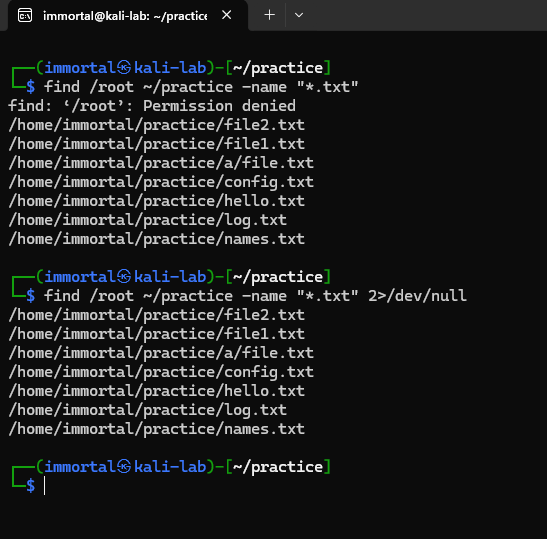
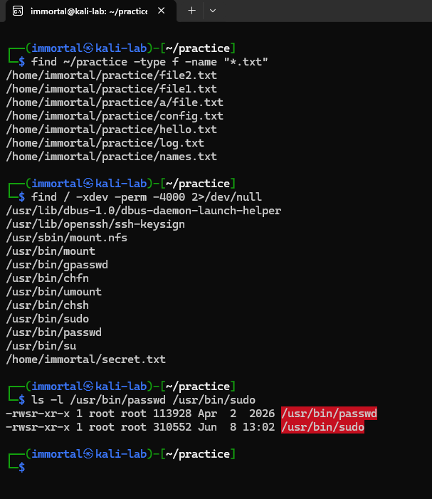
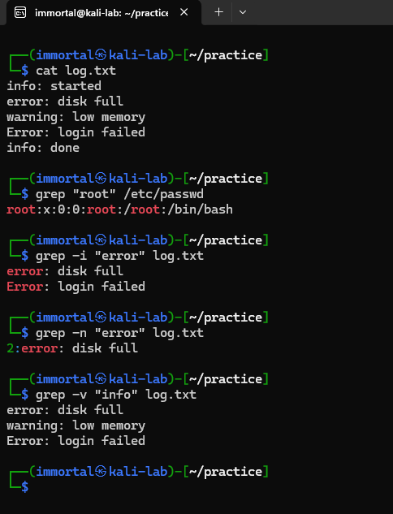
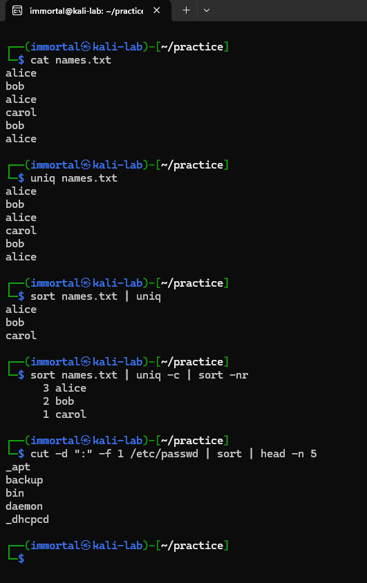
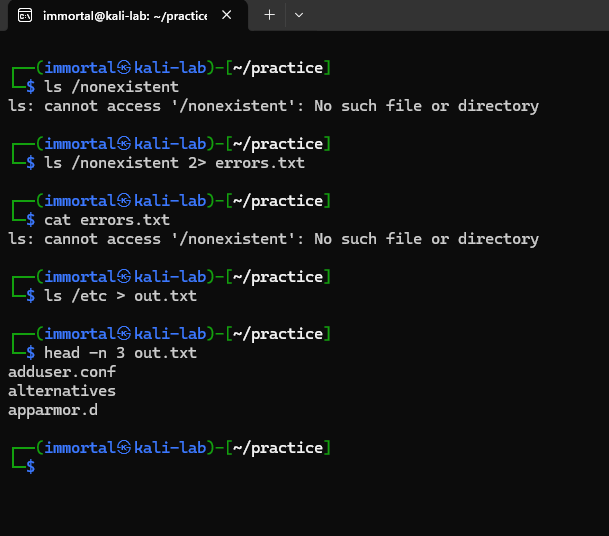
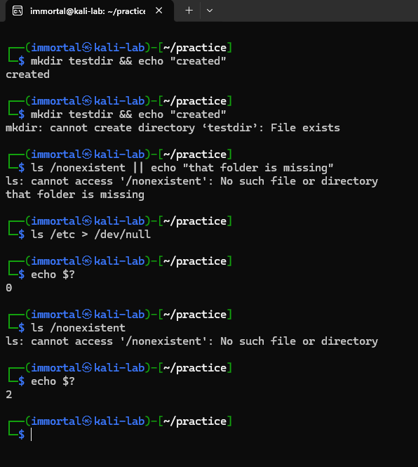

# Linux Notes: Searching and Text Processing

[Back to Linux index](README.md)

## Practice files

Some examples need files to work on. I created these in `~/practice`:

```bash
cd ~/practice
printf "alice\nbob\nalice\ncarol\nbob\nalice\n" > names.txt
printf "info: started\nerror: disk full\nwarning: low memory\nError: login failed\ninfo: done\n" > log.txt
echo "password=not-a-real-password" > config.txt
```

## Finding things: find, locate, grep, which

```bash
find / -xdev -name "passwd" 2>/dev/null      # find a file by name
find /home -type f -name "*.txt"             # find all .txt files
find / -xdev -type f -size +10M 2>/dev/null  # files larger than 10 MB
find / -xdev -perm -4000 2>/dev/null         # find SUID files
find /etc -user root -type f 2>/dev/null | head -n 5   # files owned by root (first 5 only)

locate passwd                                # fast search (run: sudo updatedb first)
which python3                                # where is this command located

grep "root" /etc/passwd                      # lines containing root
grep -i "error" log.txt                      # case-insensitive
grep -r "password" ~/practice                # search inside all files in a directory
grep -n "error" log.txt                      # show line numbers
grep -v "info" log.txt                       # show lines that do NOT match
```

- `-xdev` keeps `find` on the Linux filesystem. In WSL, `find /` would otherwise search my Windows drives under `/mnt/c`, which is slow and shows Windows paths.
- `locate` may not be installed. On Kali I install it with `sudo apt install plocate`, then run `sudo updatedb`.
- Linux has three standard data streams: 0 is standard input, 1 is standard output (normal results), and 2 is standard error (error messages).
- `2>/dev/null` hides permission errors so the output stays readable.
- `find / -perm -4000 2>/dev/null` finds SUID files, which are important for privilege escalation. See [Users and permissions](03-users-and-permissions.md) for what the SUID bit does.

### Why `2>/dev/null` matters

A normal user can't read `/root`, so `find` always complains about it. I ran the same search once without hiding the errors, and once with `2>/dev/null`:

```bash
find /root ~/practice -name "*.txt"
find /root ~/practice -name "*.txt" 2>/dev/null
```



- Without `2>/dev/null`, the first line is `find: '/root': Permission denied`, followed by my `.txt` files. On a bigger search such as `find /`, this message repeats for every directory I can't read, and the real results get buried.
- With `2>/dev/null`, the error messages go to `/dev/null` (a place that discards everything), and only the results remain.
- The list of `.txt` files is the same in both runs. Only the error stream (2) changed.

### Finding SUID files

```bash
find ~/practice -type f -name "*.txt"
find / -xdev -perm -4000 2>/dev/null
ls -l /usr/bin/passwd /usr/bin/sudo
```



- The first command lists every `.txt` file in my practice directory, including the ones I created above.
- The second command lists files with the SUID bit set. The list included `passwd`, `sudo`, `su`, `mount`, `umount`, `chsh`, `chfn` and `gpasswd`, which need to run with their owner's rights (root) even when a normal user starts them.
- `secret.txt` in my home directory is also on the list. That is a test file where I set the SUID bit myself earlier with `chmod u+s`.
- In the `ls -l` output, the `s` in `-rwsr-xr-x` is the SUID bit, shown in place of the owner's `x`. A capital `S`, as on my `secret.txt`, means SUID is set but the owner has no execute permission, so it has no real effect on that file.
- Attackers check this list because a SUID program with a weakness can give them root access. I will study this in the privilege escalation phase.

### Searching inside files with grep

```bash
grep "root" /etc/passwd
grep -i "error" log.txt
grep -n "error" log.txt
grep -v "info" log.txt
```



- `grep "root" /etc/passwd` printed only the lines that contain `root`.
- `-i` ignores case, so `grep -i "error" log.txt` matched both `error: disk full` and `Error: login failed`. Without `-i`, only the lowercase one matches.
- `-n` adds the line number in front of each match.
- `-v` inverts the match, so `grep -v "info" log.txt` printed every line that does **not** contain `info`.

## Pipes, redirection and text processing

A pipe (`|`) sends the output of one command into another. This is one of the most useful Linux skills for hacking.

```bash
cat /etc/passwd | grep "bash"        # users with a bash shell
ls /etc | wc -l                      # count items in /etc
cut -d ":" -f 1 /etc/passwd          # print only usernames (first field)
cut -d ":" -f 1,7 /etc/passwd        # username and shell
sort names.txt                       # sort lines
sort names.txt | uniq                # remove duplicate lines
sort names.txt | uniq -c | sort -nr  # count and rank duplicates
awk -F: '{print $1}' /etc/passwd     # same as cut, using awk
sed 's/error/ERROR/' log.txt         # replace text in the output (does not change the file)
tr 'a-z' 'A-Z' < log.txt             # convert to uppercase
```

- `ls /etc | wc -l` counts the items. `ls -l /etc | wc -l` would count one extra line, because `ls -l` prints a `total` line first.
- `cat file | grep pattern` works, but `grep pattern file` does the same thing in one command.

### Pipes in action

```bash
cat names.txt
uniq names.txt
sort names.txt | uniq
sort names.txt | uniq -c | sort -nr
cut -d ":" -f 1 /etc/passwd | sort | head -n 5
```



- `uniq names.txt` printed all six lines unchanged, because `uniq` only removes duplicates that are **next to each other**. In my file, no identical lines are neighbours.
- `sort names.txt | uniq` first puts identical lines together, so the result is `alice`, `bob`, `carol`. This is the same idea I used in OverTheWire Bandit.
- `sort names.txt | uniq -c | sort -nr` counts each name and ranks them from most to least frequent: `alice` appears 3 times, `bob` 2 times and `carol` once.
- The last pipeline cuts out the usernames, sorts them, and keeps the first 5 (`_apt`, `backup`, `bin`, `daemon`, `_dhcpcd`). Each command only does one small job, and the pipe joins them. `sort` ignored the leading underscore here, so `_apt` was sorted as if it were `apt`.

### Redirection

A command has three standard data streams:

| Number | Stream | Meaning |
|---|---|---|
| 0 | stdin | Standard input (keyboard or a file) |
| 1 | stdout | Standard output (normal results) |
| 2 | stderr | Standard error (error messages) |

```bash
command > file         # write output to a file (overwrite)
command >> file        # append new output at the end of the file without deleting existing content
command 2> errors      # write only errors to a file
command > all 2>&1     # write output and errors to the same file (works in every shell)
command &> all         # the same, as a shortcut in Bash and Zsh
command < file         # read input from a file
```

I tried sending normal output and errors to different files:

```bash
ls /nonexistent
ls /nonexistent 2> errors.txt
cat errors.txt
ls /etc > out.txt
head -n 3 out.txt
```



- `ls /nonexistent` on its own printed the error on the screen.
- `ls /nonexistent 2> errors.txt` printed nothing on the screen, because the error message went into `errors.txt`.
- `cat errors.txt` showed the message "No such file or directory".
- `ls /etc > out.txt` sent the normal listing into `out.txt`, and `head` showed its first lines.
- The same command can send normal output and errors to different places, which is why `2>/dev/null` works for hiding errors.

## Chaining commands: &&, ||, ; and &

Operators let me control when the next command runs.

| Operator | Meaning |
|---|---|
| `&&` | Run the second command only if the first one succeeds |
| `\|\|` | Run the second command only if the first one fails |
| `;` | Run the second command no matter what happened to the first |
| `&` | Run the command in the background |

```bash
mkdir testdir && cd testdir && echo "made it"
cd ..
mkdir testdir && echo "created"                   # fails now, so echo does NOT run
ls /nonexistent || echo "that folder is missing"  # echo runs because ls failed
cd ~/practice ; ls ; pwd                          # all three run, one after another
sleep 60 &                                        # runs in the background
```

(In the table, `\|\|` is how I write `||` so the table doesn't break. In the terminal I type `||`.)

To run the example again, I first remove the directory with `rmdir testdir`.

### Combine them for useful patterns

```bash
ping -c 1 -W 1 127.0.0.1 &> /dev/null && echo "host is up" || echo "host is down"
ping -c 1 -W 1 192.0.2.1 &> /dev/null && echo "host is up" || echo "host is down"
sudo apt update && sudo apt upgrade -y  # upgrade only if the update worked
```

- `127.0.0.1` is my own machine, so the first ping succeeds and prints "host is up".
- `192.0.2.1` is a reserved documentation address that nothing answers, so the second ping fails and prints "host is down".

### Exit status

To see whether the last command succeeded, check the exit status: `0` means success and anything else means failure.

```bash
ls /etc
echo $?  # prints 0
ls /nonexistent
echo $?  # prints a non-zero number (2)
```

I put the operators and exit status together in one screenshot. First I removed `testdir` with `rmdir testdir`, so the first `mkdir` could succeed:

```bash
mkdir testdir && echo "created"
mkdir testdir && echo "created"
ls /nonexistent || echo "that folder is missing"
ls /etc > /dev/null
echo $?
ls /nonexistent
echo $?
```



- The first `mkdir` succeeded, so `echo "created"` ran. The second `mkdir` failed with "File exists" because the directory was already there, so `echo` did not run.
- `||` ran its `echo` only because `ls /nonexistent` failed.
- `echo $?` printed `0` after a successful command and a non-zero number (2) after a failed one. `&&` and `||` use this same exit status to decide what to run next.