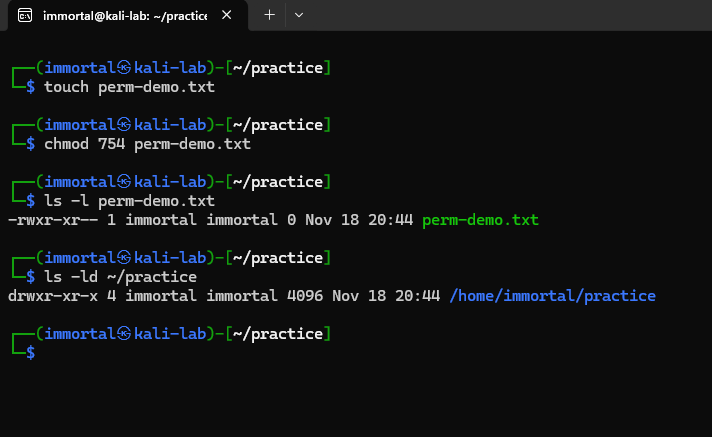
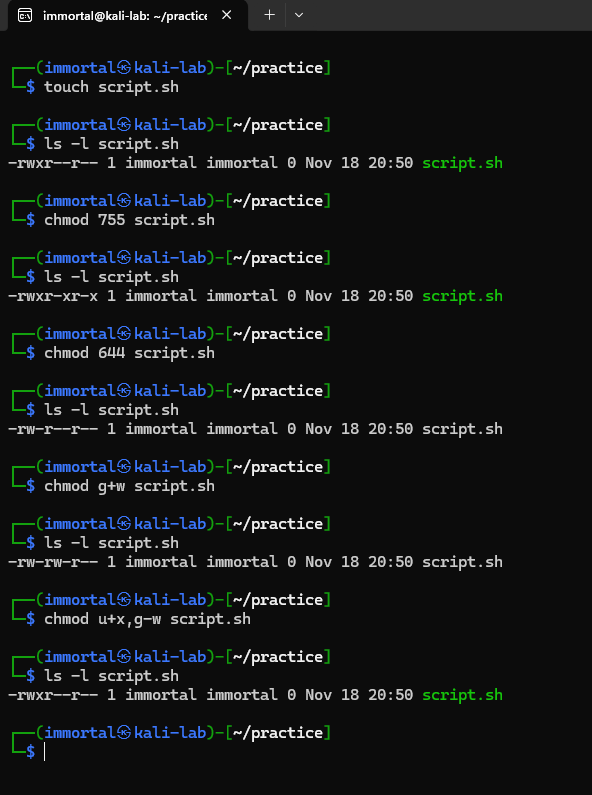
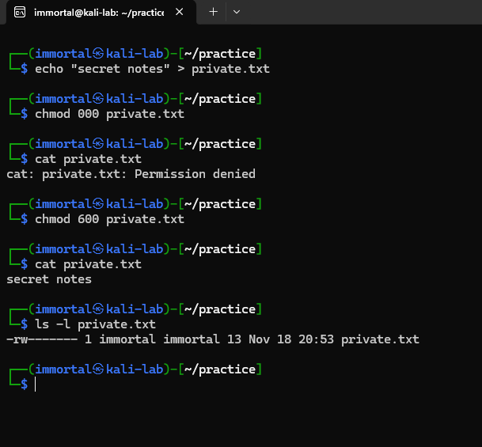
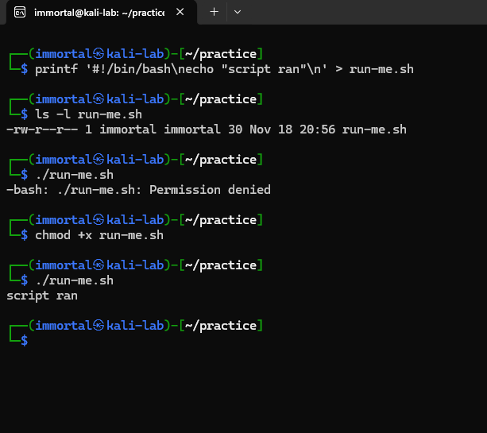
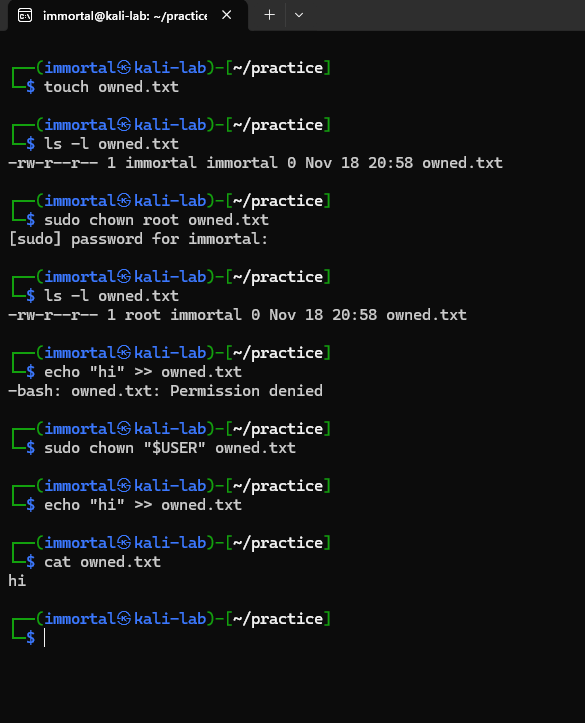
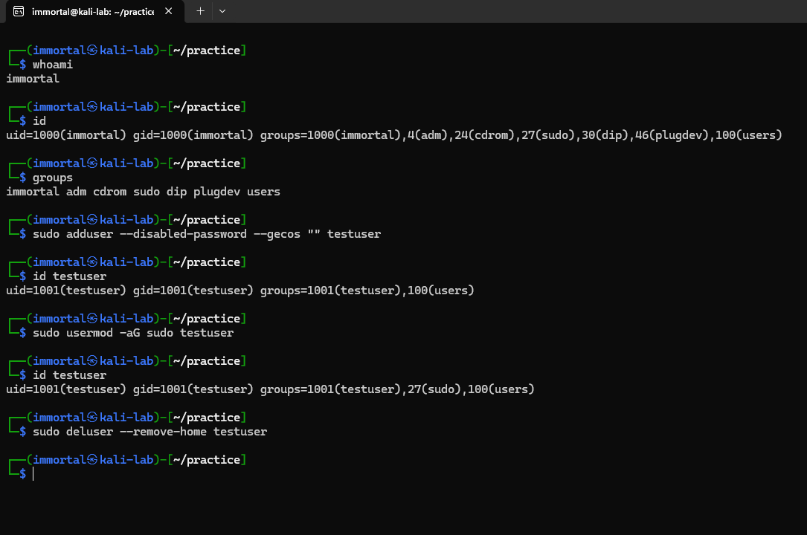
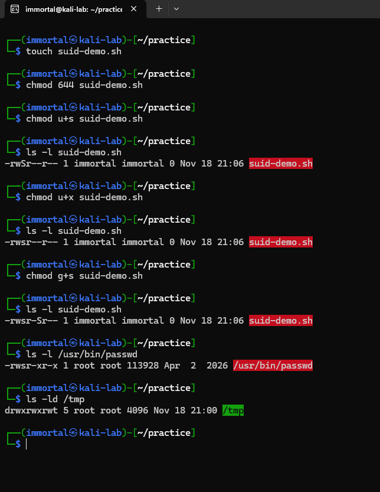

# Linux Notes: Users, Groups and Permissions

[Back to Linux index](README.md)

I practiced these commands in `~/practice` on Kali Linux in WSL2. In WSL, files under `/mnt/c` (the Windows drives) don't behave like normal Linux files, so I do the permission exercises in my Linux home directory.

## Read permissions

```bash
ls -l file.txt
```

Example output:

```text
-rwxr-xr-- 1 kali kali 120 Oct 27 10:00 file.txt
```

Breakdown: the first character is the type (`-` file, `d` directory, `l` symbolic link), then three sets of `rwx` for **owner**, **group** and **others**.

- `r` = read (4), `w` = write (2), `x` = execute (1)
- So `-rwxr-xr--` reads as: type `-`, owner `rwx`, group `r-x`, others `r--`
- The owner has read, write and execute permission, the group has read and execute, and others have only read
- A `-` (hyphen) in a slot means that permission is not granted, so `r-x`, `r--`, `--x` and `---` are all possible patterns

### Numeric (octal) values

Each set of three permissions adds up to one number: read 4 + write 2 + execute 1.

| Number | Permissions | Meaning |
|---|---|---|
| 7 | `rwx` | read, write, execute (4+2+1) |
| 6 | `rw-` | read, write (4+2) |
| 5 | `r-x` | read, execute (4+1) |
| 4 | `r--` | read only |
| 0 | `---` | no permissions |

So `754` means owner `7` (`rwx`), group `5` (`r-x`), others `4` (`r--`), which is `-rwxr-xr--`.

I created a file with `754` and looked at it, along with the practice directory:

```bash
cd ~/practice
touch perm-demo.txt
chmod 754 perm-demo.txt
ls -l perm-demo.txt
ls -ld ~/practice
```



- The file shows `-rwxr-xr--`, which matches `754`: the owner can read, write and execute, the group can read and execute, and others can only read.
- The first character of the directory line is `d`, so `~/practice` is a directory.
- The next two names after the link count are the **owner** and the **group** of the file.

### What the permissions mean for a directory

| Permission | On a file | On a directory |
|---|---|---|
| `r` | read the contents | list the names inside |
| `w` | change the contents | create, delete and rename files inside |
| `x` | run it as a program | enter it with `cd` and reach files inside |

Without `x` on a directory, I can't `cd` into it, even if I have `r`.

## Changing permissions

```bash
chmod 755 script.sh   # owner rwx, group r-x, others r-x (r=4, w=2, x=1)
chmod 644 notes.txt   # owner rw-, group r--, others r--
chmod +x script.sh    # add execute for everyone (user, group and others)
chmod u+x,g-w file    # symbolic: user plus x (add execute for user), group minus w (remove write for group)
chmod -R 750 folder/  # recursively
```

- In symbolic mode, `u` is the user (owner), `g` is the group, `o` is others and `a` is all. `+` adds a permission, `-` removes it and `=` sets it exactly.
- `chmod -R 750 folder/` also makes every **file** inside executable. A safer version is `chmod -R u=rwX,g=rX,o= folder/`, where the capital `X` adds execute only to directories and to files that are already executable.

I changed a file's permissions with numbers and with symbols, and checked it with `ls -l` each time:

```bash
touch script.sh
ls -l script.sh
chmod 755 script.sh
ls -l script.sh
chmod 644 script.sh
ls -l script.sh
chmod g+w script.sh
ls -l script.sh
chmod u+x,g-w script.sh
ls -l script.sh
```



- This `script.sh` already existed from earlier practice (`touch` only updates the date of an existing file), so it started as `-rwxr--r--`. A brand-new file normally starts as `-rw-r--r--` (`644`), because of the default umask.
- `chmod 755` changed it to `-rwxr-xr-x`, and `chmod 644` changed it back.
- `g+w` added write for the group, giving `-rw-rw-r--`.
- `u+x,g-w` added execute for the owner and removed write for the group in one command, giving `-rwxr--r--`.

### Permissions are enforced

I removed all permissions from a file, tried to read it, then gave the owner read and write back:

```bash
echo "secret notes" > private.txt
chmod 000 private.txt
cat private.txt
chmod 600 private.txt
cat private.txt
ls -l private.txt
```



- With `chmod 000`, `cat private.txt` printed `Permission denied`, even though I own the file. The owner's permissions apply to the owner, so removing them blocks me too. The owner can always change them back with `chmod`.
- After `chmod 600` (`rw-` for the owner and nothing for anyone else), `cat` worked again, and `ls -l` showed `-rw-------`.
- `600` is the permission I want for private files. SSH refuses to use a private key whose permissions are too open, so keys are usually `600`.
- The root user can read the file even with `000`, because root bypasses the normal permission checks.

A file can only be run as a program if it has execute permission:

```bash
printf '#!/bin/bash\necho "script ran"\n' > run-me.sh
ls -l run-me.sh
./run-me.sh
chmod +x run-me.sh
./run-me.sh
```



- The new file was `-rw-r--r--`, with no `x`, so `./run-me.sh` printed a "permission denied" message. The wording depends on the shell (bash and zsh differ).
- After `chmod +x`, the same command printed `script ran`.

## Ownership

```bash
chown user file.txt        # change owner (needs sudo)
chown user:group file.txt  # change owner and group
id                         # your user id and groups
whoami                     # current user
groups                     # your groups
```

I changed the owner of a file to root, tried to write to it, then took it back:

```bash
touch owned.txt
ls -l owned.txt
sudo chown root owned.txt
ls -l owned.txt
echo "hi" >> owned.txt
sudo chown "$USER" owned.txt
echo "hi" >> owned.txt
cat owned.txt
```



- The file started with my username as the owner.
- After `sudo chown root owned.txt`, the owner column showed `root`. The group was still my group, and the group only has read permission (`r--`), so writing with `>>` failed with "permission denied".
- After `sudo chown "$USER" owned.txt`, I was the owner again, and the write worked.
- Only root can change a file's owner, which is why `chown` needs `sudo`. A normal user can only change the permissions of files they own.

## Users and sudo

```bash
sudo adduser testuser           # create a user (set a password when asked)
sudo usermod -aG sudo testuser  # add to the sudo group
su testuser                     # switch user
sudo -l                         # list what you can run with sudo
sudo passwd testuser            # change a password
sudo deluser testuser           # delete the user
```

- `sudo` runs one command as root. It only works for users in the `sudo` group (or listed in `/etc/sudoers`).
- In `usermod -aG sudo testuser`, the `-a` (append) is important. Without it, `-G` replaces all of the user's other groups.
- `su - testuser` switches to that user with their own environment, and `exit` returns to my user.
- `sudo deluser testuser` leaves the home directory behind. `sudo deluser --remove-home testuser` deletes it as well.

I looked at my own identity, then created a test user and added it to the `sudo` group. For the screenshot I used the non-interactive form of `adduser`, so no password prompts appeared:

```bash
whoami
id
groups
sudo adduser --disabled-password --gecos "" testuser
id testuser
sudo usermod -aG sudo testuser
id testuser
sudo deluser --remove-home testuser
```



- `whoami` printed my username, and `id` and `groups` listed my user ID and groups. My groups include `sudo`, which is why I can run `sudo`.
- After `adduser`, `id testuser` showed the new user (user ID 1001) in its own group and in the `users` group, but not in `sudo`.
- After `usermod -aG sudo testuser`, `id testuser` listed `27(sudo)` as well, and the other groups were kept because of the `-a`.
- The last command deleted the test user and its home directory, so nothing stays on my system.

## Special permissions (very important for privilege escalation)

- **SUID** (`s` in the owner position, like `-rwsr-xr-x`): the program runs with the owner's rights. Example: `/usr/bin/passwd`.
- **SGID** (`s` in the group position): runs with the group's rights. On a directory, new files inherit the directory's group.
- **Sticky bit** (`t`, like `drwxrwxrwt` on `/tmp`): users can only delete their own files in the directory.

| Special bit | Symbolic | Numeric (first digit) |
|---|---|---|
| SUID | `chmod u+s file` | `4` (for example `chmod 4755 file`) |
| SGID | `chmod g+s file` | `2` |
| Sticky | `chmod +t dir` | `1` |

```bash
ls -l /usr/bin/passwd
ls -ld /tmp
chmod u+s file  # set SUID (for learning only)
```

I set the special bits on a test file and looked at them next to the real `passwd` and `/tmp`:

```bash
touch suid-demo.sh
chmod 644 suid-demo.sh
chmod u+s suid-demo.sh
ls -l suid-demo.sh
chmod u+x suid-demo.sh
ls -l suid-demo.sh
chmod g+s suid-demo.sh
ls -l suid-demo.sh
ls -l /usr/bin/passwd
ls -ld /tmp
```



- `ls` colors SUID files with a red background, which is why `suid-demo.sh` and `/usr/bin/passwd` are highlighted.
- After `u+s` on a file with no execute permission, the owner slot showed a capital `S` (`-rwSr--r--`). The capital `S` means the SUID bit is set, but the owner cannot execute the file, so it does nothing useful.
- After `u+x`, it became a lowercase `s` (`-rwsr--r--`), which is a working SUID file.
- `g+s` set SGID, and it showed as an `S` in the group slot, because the group doesn't have execute permission either.
- `/usr/bin/passwd` is owned by root and shows `-rwsr-xr-x`. This is why a normal user can run `passwd` to change their own password: it runs as root and can write to the protected password files.
- `/tmp` shows `drwxrwxrwt`. Everyone can write there, and the `t` (sticky bit) stops users from deleting each other's files.
- Attackers look for SUID programs with weaknesses, because they run as root. I will study this in the privilege escalation phase.

## Cleaning up

```bash
rm perm-demo.txt script.sh private.txt run-me.sh owned.txt suid-demo.sh
```