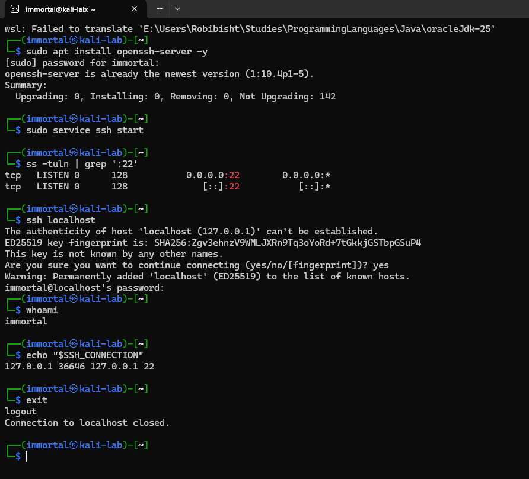
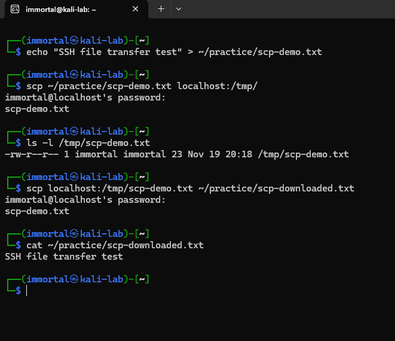
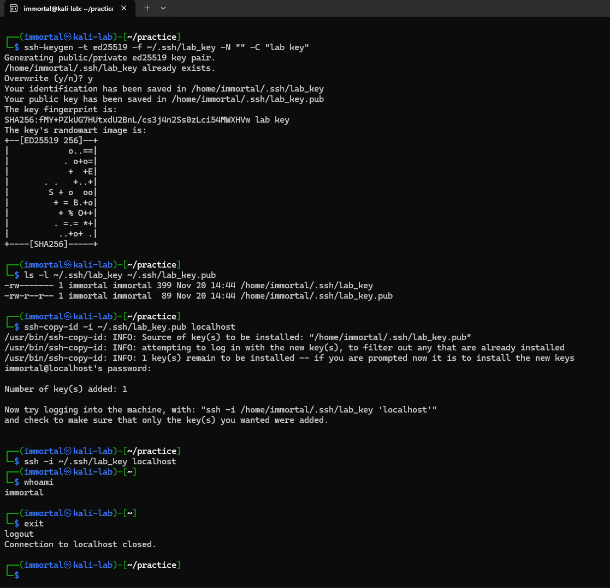
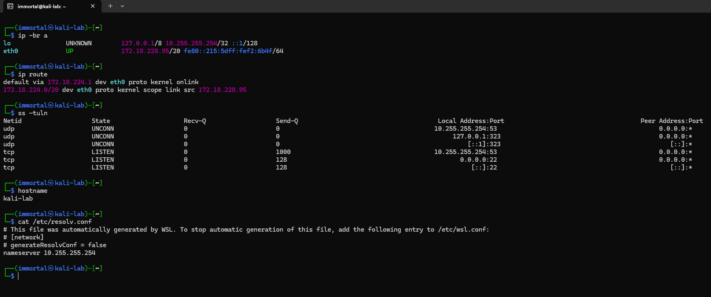
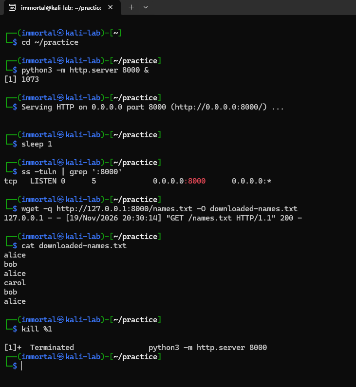

# Linux Notes: SSH and Basic Networking

[Back to Linux index](README.md)

I practiced these commands on Kali Linux in WSL2. A real SSH login between two machines needs two systems on the same network, such as two VirtualBox VMs. On one machine I used `localhost` (the machine connecting to itself), and I kept the two-machine commands below as reference.

## SSH: logging in to a remote machine

SSH (Secure Shell) lets me control another machine's terminal over an encrypted connection. It uses TCP port 22 by default.

### Between two machines (VirtualBox VMs)

On the Ubuntu VM (the machine I connect to):

```bash
sudo apt update                     # refresh the package list
sudo apt install openssh-server -y  # install SSH
sudo systemctl start ssh            # start SSH
sudo systemctl enable ssh           # start SSH at boot
sudo systemctl status ssh           # should show active (running); press q to exit
ip a                                # note the IP address (for example 192.168.56.101)
```

On the Kali VM (the machine I connect from):

```bash
ssh ubuntuusername@192.168.56.101  # use my Ubuntu login username
```

Type `yes` the first time, then enter the password. The prompt will change to the remote machine. Type `exit` to leave.

### On one machine (WSL, using localhost)

I installed the SSH server and connected to it from the same machine. `service` works whether or not systemd is enabled in WSL, while `systemctl` only works with systemd.

```bash
sudo apt install openssh-server -y
sudo service ssh start
ss -tuln | grep ':22'
ssh localhost
whoami
echo "$SSH_CONNECTION"
exit
```



- `sudo service ssh start` started the SSH server, and `ss -tuln | grep ':22'` showed a `LISTEN` line for port 22, so the server was waiting for connections.
- On the first connection, SSH asks whether to trust the host key. After I type `yes`, it saves the key in `~/.ssh/known_hosts` and does not ask again.
- `ssh localhost` asks for my password (it is not shown while I type), then gives me a shell on the "remote" machine, which is the same machine here.
- `$SSH_CONNECTION` lists the client address and port, then the server address and port (22). It proves that this shell is running through SSH.
- `exit` closed the connection and returned me to my normal shell.

### Copy files with scp

```bash
scp file.txt user@192.168.56.101:/home/user/   # upload to another machine
scp user@192.168.56.101:/home/user/file.txt .  # download from another machine
```

On one machine, I copied a file to `/tmp` over SSH and back again:

```bash
echo "SSH file transfer test" > ~/practice/scp-demo.txt
scp ~/practice/scp-demo.txt localhost:/tmp/
ls -l /tmp/scp-demo.txt
scp localhost:/tmp/scp-demo.txt ~/practice/scp-downloaded.txt
cat ~/practice/scp-downloaded.txt
```



- Each `scp` asked for my password and then printed a progress line with the file name, `100%` and the size.
- The first `scp` uploaded the file to `/tmp`, and `ls -l` confirmed it arrived.
- The second `scp` downloaded it under a new name, and `cat` showed that the content was the same.
- The format is `scp source destination`, and the remote side is written `user@host:path`.

### Key-based login (more secure and a good thing to learn)

```bash
ssh-keygen -t ed25519
ssh-copy-id user@192.168.56.101
ssh user@192.168.56.101  # now works without a password
```

For a lab key that doesn't overwrite my real one, I used a separate file name. I left the passphrase empty only because this is a throwaway lab key. A real key should have a passphrase.

```bash
ssh-keygen -t ed25519 -f ~/.ssh/lab_key -N "" -C "lab key"
ls -l ~/.ssh/lab_key ~/.ssh/lab_key.pub
ssh-copy-id -i ~/.ssh/lab_key.pub localhost
ssh -i ~/.ssh/lab_key localhost
whoami
exit
```



- `ssh-keygen` made a key pair: the private key `lab_key` and the public key `lab_key.pub`. It also printed a fingerprint and a small picture called randomart.
- `ls -l` shows the private key with `-rw-------` (only me), and the public key with `-rw-r--r--`. SSH refuses to use a private key that other users can read.
- `ssh-copy-id` asked for my password once, and added the public key to `~/.ssh/authorized_keys` on the target.
- After that, `ssh -i ~/.ssh/lab_key localhost` logged in without asking for the account password. The server checked the key instead.
- I share the public key freely, but the private key stays on my machine and is never uploaded.

## Basic networking commands

```bash
ip a                        # your IP addresses and interfaces
ip route                    # routing table and default gateway
ping -c 4 8.8.8.8           # test connectivity (4 packets)
ss -tuln                    # open listening ports
sudo ss -tulnp              # include the program using each port
hostname                    # machine name
cat /etc/resolv.conf        # DNS settings
curl http://example.com     # fetch a web page
wget http://example.com/ -O example.html   # download a page to a file
```

- `ping -c 4` sends 4 packets and stops. On a VirtualBox lab I ping the other VM, for example `192.168.56.101`.
- `ss -tuln` shows TCP (`t`) and UDP (`u`) sockets that are listening (`l`), with numbers instead of names (`n`).

```bash
ip -br a
ip route
ss -tuln
hostname
cat /etc/resolv.conf
```



- `ip -br a` is the short form of `ip a`. It lists each interface, its state and its address. `lo` is the loopback interface (`127.0.0.1`), and the other interface is WSL's virtual network card.
- `ip route` shows the default route, which is the gateway my traffic leaves through. In WSL this is a virtual address provided by Windows.
- `ss -tuln` lists the listening ports. The `Local Address:Port` column shows which port each service listens on.
- `/etc/resolv.conf` holds my DNS server. WSL generates this file, and the server address is a virtual one from Windows.

## Sharing files with a quick web server

```bash
cd ~/practice
python3 -m http.server 8000
```

Then, from another machine, I can run `wget http://IP-OF-THIS-MACHINE:8000/file.txt`. This exact trick is used in real CTFs and pentests to transfer files. The server shares the **whole directory** it was started in, so I start it only in a practice directory with nothing private, and stop it when I'm done.

On one machine, I started the server in the background and downloaded a file from it:

```bash
cd ~/practice
python3 -m http.server 8000 &
sleep 1
ss -tuln | grep ':8000'
wget -q http://127.0.0.1:8000/names.txt -O downloaded-names.txt
cat downloaded-names.txt
kill %1
```



- `python3 -m http.server 8000 &` printed "Serving HTTP on 0.0.0.0 port 8000", so it listens on all interfaces. The `&` runs it in the background so I can keep typing.
- `ss -tuln` showed a `LISTEN` line for port 8000.
- `wget` fetched `names.txt` over HTTP, and the server printed a log line for the request (`GET /names.txt` with status `200`).
- `cat` showed that the downloaded file matches the original.
- `kill %1` stopped the server (job number 1), The job number may differ.

## Cleaning up

```bash
sudo service ssh stop
rm ~/.ssh/lab_key ~/.ssh/lab_key.pub
sed -i '/lab key/d' ~/.ssh/authorized_keys
rm ~/practice/scp-demo.txt ~/practice/scp-downloaded.txt /tmp/scp-demo.txt ~/practice/downloaded-names.txt
```