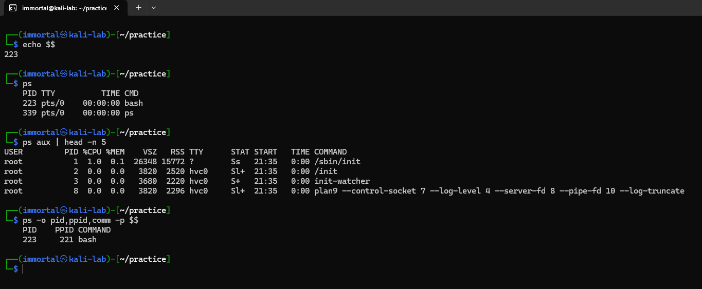
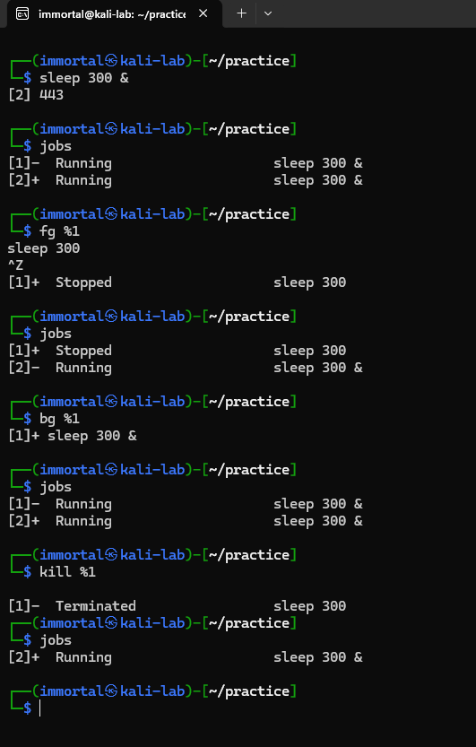
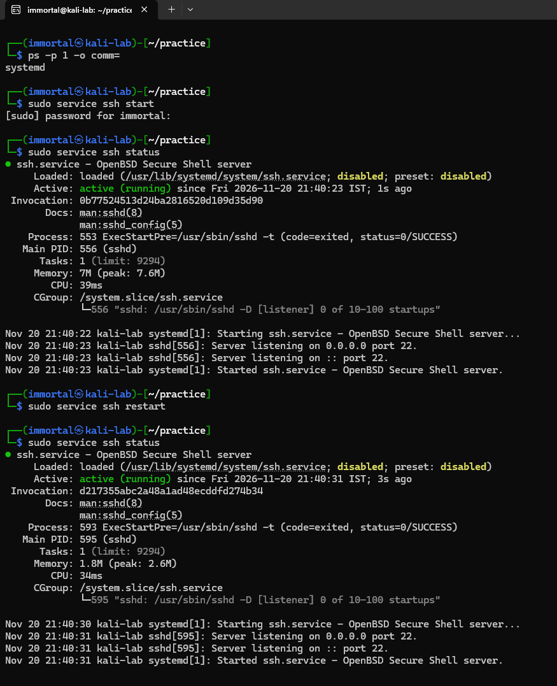
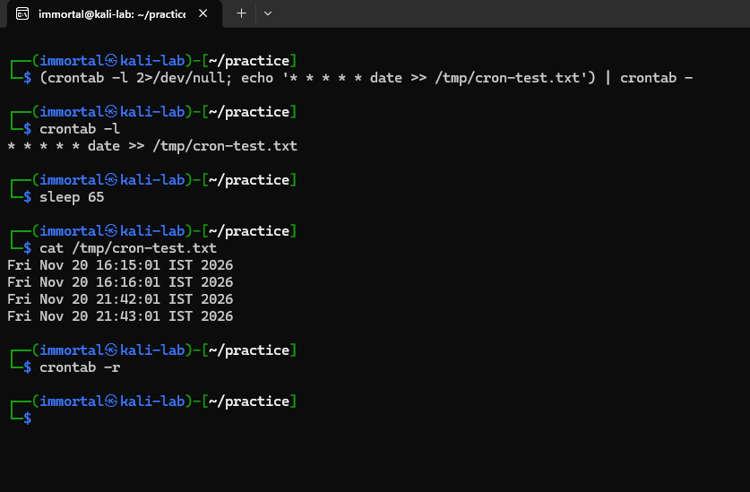
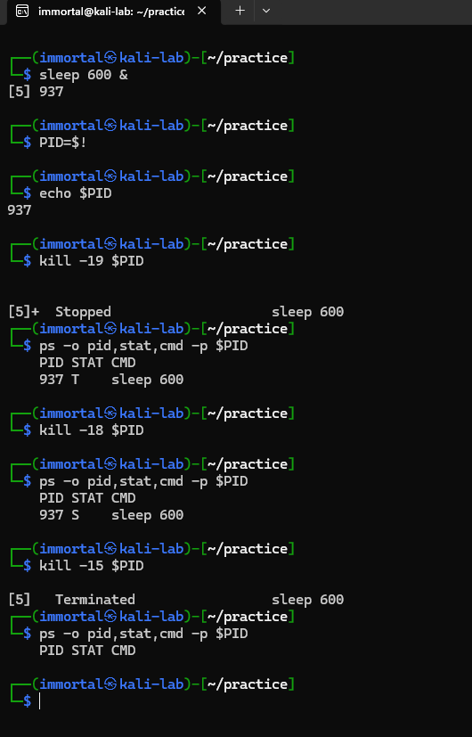

# Linux Notes: Processes, Services and Cron

[Back to Linux index](README.md)

I practiced these commands on Kali Linux in WSL2. WSL may not run systemd, so I check what is running as PID 1 first:

```bash
ps -p 1 -o comm=
```

If it prints `systemd`, I can use `systemctl`. If it prints `init`, I use `service` instead.

## Processes and services

### Viewing processes

```bash
ps                 # processes associated with your current terminal
ps aux             # all processes on the system
pgrep -a ssh       # find a specific process by name
top                # live view (q to quit)
htop               # nicer version (sudo apt install htop)
```

- `ps aux | grep ssh` also works, but it lists the `grep` command itself in the results. `pgrep -a ssh` avoids that.

```bash
echo $$
ps
ps aux | head -n 5
ps -o pid,ppid,comm -p $$
```



- `echo $$` printed the PID of my current shell.
- Plain `ps` listed only the processes in my terminal (the shell and `ps` itself).
- `ps aux | head -n 5` listed the first processes on the system, with their user, PID, CPU and memory use, state and command.
- `ps -o pid,ppid,comm -p $$` showed my shell's PID and its **PPID**, the PID of the parent process that started it.

### Controlling processes

```bash
sleep 300 &   # run a command in the background
jobs          # list background jobs
fg %1         # bring job 1 to the foreground
kill 1234     # stop the process with PID 1234
kill -9 1234  # force-kill
pkill sleep   # kill by name
```

I started a job in the background, brought it to the foreground, paused it with `Ctrl + Z`, resumed it in the background, and stopped it:

```bash
sleep 300 &
jobs
fg %1
# press Ctrl + Z here
jobs
bg %1
jobs
kill %1
jobs
```



- `sleep 300 &` printed the job number and PID, and `jobs` showed it as `Running`.
- `fg %1` brought the job to the foreground, so the terminal waited for it.
- `Ctrl + Z` paused it, and `jobs` showed `Stopped`.
- `bg %1` resumed it in the background, and `jobs` showed `Running` again.
- `kill %1` terminated the job, and the next `jobs` showed `Terminated` (or nothing).

### Services

A service is a program that runs in the background, such as the SSH server.

```bash
systemctl status ssh --no-pager
sudo systemctl stop ssh
sudo systemctl start ssh
sudo systemctl restart ssh
sudo systemctl enable ssh   # start at boot
sudo systemctl disable ssh  # do not start at boot
systemctl list-units --type=service
```

The same actions with `service`, which also works when systemd is not running:

```bash
sudo service ssh status
sudo service ssh stop
sudo service ssh start
sudo service ssh restart
```

- `--no-pager` stops `systemctl status` from opening a pager that waits for `q`.
- `enable` and `disable` control starting at boot, which is different from `start` and `stop`, which act right now.

```bash
ps -p 1 -o comm=
sudo service ssh start
sudo service ssh status
sudo service ssh restart
sudo service ssh status
```



- `ps -p 1 -o comm=` showed what runs as PID 1 on my WSL (`init` or `systemd`).
- `service ssh status` showed whether the SSH server was running, and I restarted it and checked again.
- This is the same idea as `systemctl status` and `systemctl restart ssh` on a system with systemd.

## Scheduled tasks: cron jobs

Cron runs commands on a schedule. Attackers also abuse misconfigured cron jobs, so understanding them matters. In WSL, cron may need installing and starting first:

```bash
sudo apt install cron -y
sudo service cron start
```

```bash
crontab -e      # edit your cron jobs
crontab -l      # list your cron jobs
ls /etc/cron.d  # system cron jobs
cat /etc/crontab
```

Format: `minute hour day-of-month month day-of-week command`

| Field | Allowed values |
|---|---|
| minute | 0 to 59 |
| hour | 0 to 23 |
| day of month | 1 to 31 |
| month | 1 to 12 |
| day of week | 0 to 7 (0 and 7 are Sunday, 1 is Monday) |

```bash
* * * * * echo "hi" >> /tmp/cron-test.txt  # every minute
0 2 * * * /home/user/backup.sh             # every day at 2:00
*/5 * * * * date >> /tmp/time.log          # every 5 minutes
0 9 * * 1 /home/user/weekly.sh             # Mondays at 9:00
```

I added a job that writes the date every minute, waited, and read the file. `crontab -r` removes **all** my cron jobs, so I only use it when my crontab holds nothing else:

```bash
(crontab -l 2>/dev/null; echo '* * * * * date >> /tmp/cron-test.txt') | crontab -
crontab -l
sleep 65
cat /tmp/cron-test.txt
crontab -r
```



- The first command appended a new line to my existing crontab (if any) and loaded it. This does the same as `crontab -e`, without opening an editor.
- `crontab -l` listed the job.
- After about a minute, `/tmp/cron-test.txt` contained a date line written by cron, which proves the job ran on its own.
- `crontab -r` removed the job when I finished.

## Process IDs and signals in depth

Every running process has a **PID** (process ID) and a **PPID** (its parent's ID). The first process, PID 1 (`systemd` or `init`), starts all the others.

```bash
ps -ef             # all processes with PID and PPID
pgrep -a ssh       # find a process
pstree             # show the parent and child tree
echo $$            # the PID of your current shell
ls /proc/$$        # the live data Linux keeps about that process
```

**Signals** are messages sent to processes. `kill` does not only kill; it sends any signal.

```bash
kill -l        # list all signals
kill -15 1234  # SIGTERM: politely ask the process to stop (the default)
kill -9 1234   # SIGKILL: force it to stop immediately, no cleanup
kill -19 1234  # SIGSTOP: pause the process
kill -18 1234  # SIGCONT: resume a paused process
kill -1 1234   # SIGHUP: hang up; many services reload their config
```

| Signal | Number | Meaning |
|---|---|---|
| SIGHUP | 1 | Terminal closed or reload configuration |
| SIGINT | 2 | Interrupt (Ctrl + C) |
| SIGTERM | 15 | Polite request to terminate |
| SIGKILL | 9 | Force kill |
| SIGSTOP | 19 | Pause a process |
| SIGCONT | 18 | Resume a process |

Keyboard shortcuts in a terminal:

- `Ctrl + C` stops the foreground process (SIGINT)
- `Ctrl + Z` pauses it and returns me to the shell
- Then `bg` resumes it in the background, or `fg` brings it back to the front

I sent signals to a background process and checked its state each time. `$!` holds the PID of the last background job, so I didn't have to type a PID:

```bash
sleep 600 &
PID=$!
echo $PID
kill -19 $PID
ps -o pid,stat,cmd -p $PID
kill -18 $PID
ps -o pid,stat,cmd -p $PID
kill -15 $PID
ps -o pid,stat,cmd -p $PID
```



- After `kill -19` (SIGSTOP), the state column showed `T`, which means stopped.
- After `kill -18` (SIGCONT), the state went back to `S` (sleeping), so the process was running again.
- After `kill -15` (SIGTERM), the process ended, and the last `ps` printed only the header line.
- The state letters I need to know: `R` running, `S` sleeping, `T` stopped, `Z` zombie.

To keep a process running after I close the terminal, start it with `nohup`. It writes the output to `nohup.out` in the current directory:

```bash
nohup python3 -m http.server 8000 &
```

Use `kill -15` first and only use `kill -9` when a process will not stop, because `-9` skips cleanup such as closing files.