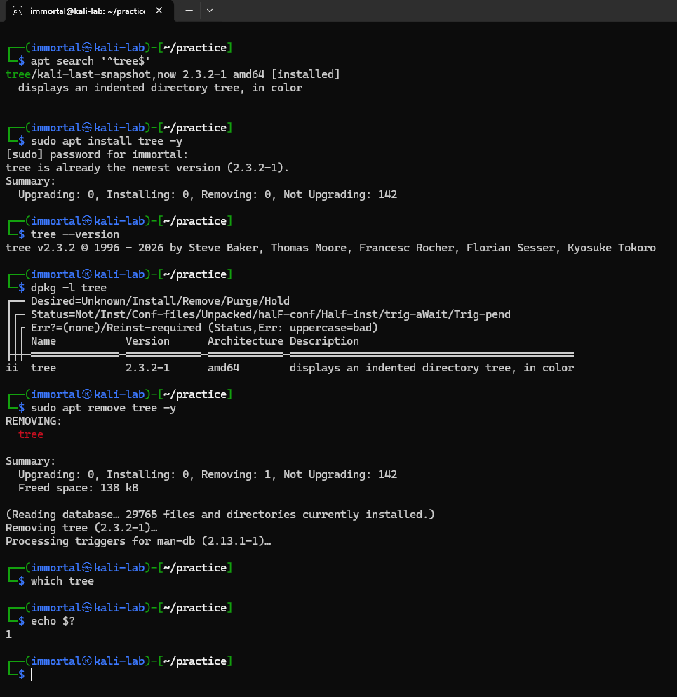
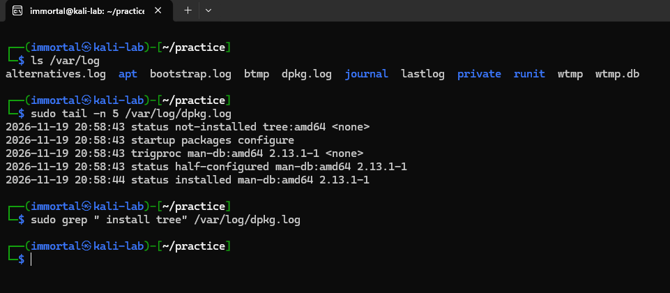

# Linux Notes: Packages and Logs

[Back to Linux index](README.md)

I practiced these commands on Kali Linux in WSL2.

## Package management

On Debian-based systems (Kali, Ubuntu) I use `apt`.

```bash
sudo apt update              # refresh the package list
apt list --upgradable        # show packages that have updates
sudo apt upgrade -y          # upgrade installed packages
sudo apt install tree -y     # install a package
sudo apt remove tree         # remove it (keeps its config files)
sudo apt purge tree          # remove it and its config files
sudo apt autoremove          # remove packages that were installed only as dependencies
apt search nmap | head       # search packages (the full list is long)
apt show nmap                # package details
dpkg -l | grep nmap          # check whether it is installed
sudo apt install ./package.deb   # install a downloaded .deb file and resolve its dependencies
sudo dpkg -i package.deb         # install a .deb file directly (does not fetch dependencies)
```

- `apt update` only refreshes the list of available packages, and `apt upgrade` installs the newer versions.
- `apt` is the friendly command for everyday use, and `dpkg` is the lower-level tool that works on individual `.deb` files.

I searched for a package, installed it, checked it, and removed it:

```bash
apt search '^tree$'
sudo apt install tree -y
tree --version
dpkg -l tree
sudo apt remove tree -y
which tree
echo $?
```



- `apt search '^tree$'` found the package named exactly `tree`. The `^` and `$` match the start and end of the name, so related packages don't clutter the list.
- `apt install tree -y` downloaded and installed it, and `tree --version` confirmed that the command works.
- `dpkg -l tree` listed the package, and its status `ii` means installed.
- After `apt remove`, `which tree` printed nothing, and `echo $?` printed `1`, which means the command was not found.

## apt repositories and third-party software sources

`apt` installs software from **repositories**: servers that hold packages. My system lists them in:

```bash
cat /etc/apt/sources.list    # main list of repositories
ls /etc/apt/sources.list.d/  # extra repository files
```

Newer systems may keep the main repository in a `.sources` file inside `/etc/apt/sources.list.d/` instead.

```bash
cat /etc/apt/sources.list
ls /etc/apt/sources.list.d/
cat /etc/apt/sources.list.d/*.sources 2>/dev/null | head -n 12
```


- A one-line entry such as `deb http://http.kali.org/kali kali-rolling main contrib non-free non-free-firmware` has four parts: the type (`deb` for binary packages), the repository URL, the release name (`kali-rolling`), and the components (`main`, `contrib` and so on).
- In the newer `.sources` format, the same information appears as named fields such as `Types`, `URIs`, `Suites`, `Components` and `Signed-By`.
- `Signed-By` points to the GPG key file that apt uses to check the repository's signatures.
- Kali's repositories are set up for security tools. Whichever format my system uses, the screenshot shows the real one.

Adding a third-party source has three parts:

1. Download the vendor's **GPG signing key**. This lets apt check that packages really come from them.
2. Add a **source entry** that points to their repository.
3. Run `sudo apt update`, then install the package.

**Step 1: Save the vendor's key** (the URL and names below are placeholders; use the vendor's official instructions)

```bash
sudo mkdir -p /etc/apt/keyrings
curl -fsSL https://example.com/vendor-key.gpg | sudo gpg --dearmor -o /etc/apt/keyrings/vendor.gpg
```

**Step 2: Add the repository, tied to that key**

```bash
echo "deb [signed-by=/etc/apt/keyrings/vendor.gpg] https://example.com/apt stable main" | sudo tee /etc/apt/sources.list.d/vendor.list
```

**Step 3: Refresh and install**

```bash
sudo apt update
sudo apt install vendor-package
```

On Ubuntu, a **PPA** (Personal Package Archive) is a shortcut:

```bash
sudo add-apt-repository ppa:name/ppa
sudo apt update
```

To remove a source: delete its file in `/etc/apt/sources.list.d/` (and its key in `/etc/apt/keyrings/`), then run `sudo apt update`.

Security notes:

- Every extra repository can install code with root access, so only add sources I trust, from the vendor's official documentation.
- Older tutorials use `apt-key add`, which is deprecated. Use the `signed-by` method above.
- Do not add random Ubuntu repositories to Kali, because mixing them can break the system. Back up or snapshot first.

## Logs

Logs show what happened on the system. As a hacker I read them to understand detection; as a defender I read them to find attacks.

```bash
ls /var/log
sudo tail -n 20 /var/log/syslog    # general system log (Ubuntu)
sudo tail -n 20 /var/log/auth.log  # logins and sudo use (Ubuntu with rsyslog)
sudo tail -f /var/log/auth.log     # follow live (Ctrl+C to stop)
sudo journalctl -u ssh -n 20       # logs for the ssh service
sudo journalctl -xe                # recent logs with explanations
sudo grep "Failed password" /var/log/auth.log
last                               # login history
```

If `/var/log/auth.log` does not exist, my system uses the systemd journal, so I use `journalctl` instead. In WSL, `journalctl` only works when systemd is running, and `auth.log` may be missing, so I used the package logs that always exist, because I had just installed and removed a package:

```bash
ls /var/log
sudo tail -n 5 /var/log/dpkg.log
sudo grep " install tree" /var/log/dpkg.log
```



- `/var/log` holds the log files, and `ls` showed which ones exist on my system. A log such as `auth.log` or `syslog` only exists if a logging service is running.
- `/var/log/dpkg.log` records every package action with a timestamp. The `tail` command showed the most recent entries.
- The `grep " install tree"` line found the moment I installed `tree`, with the date, time and version.
- This is the same idea as reading `auth.log` for logins. A log is a time-ordered record, and `grep` finds the line I need.