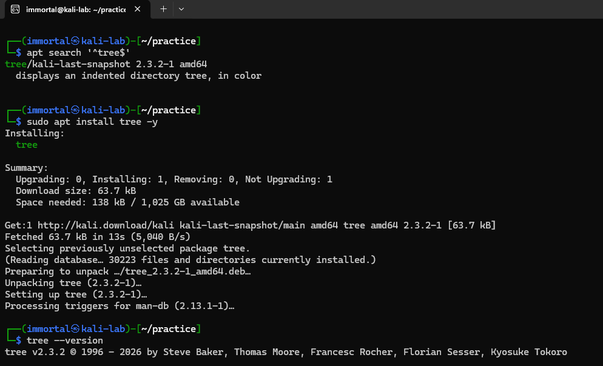
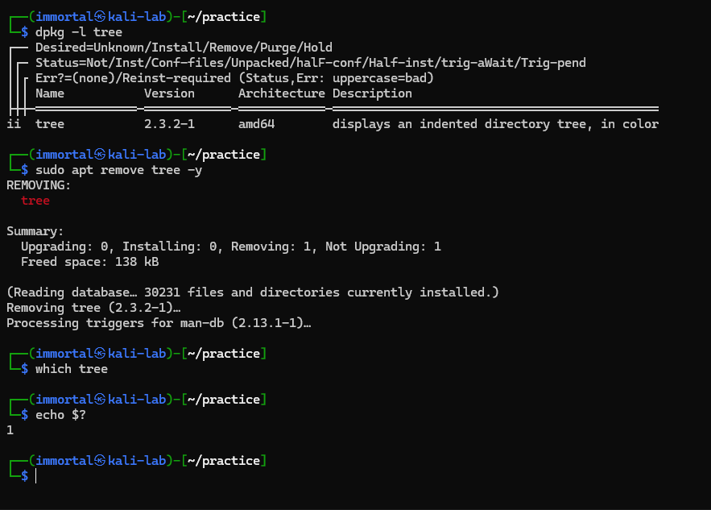
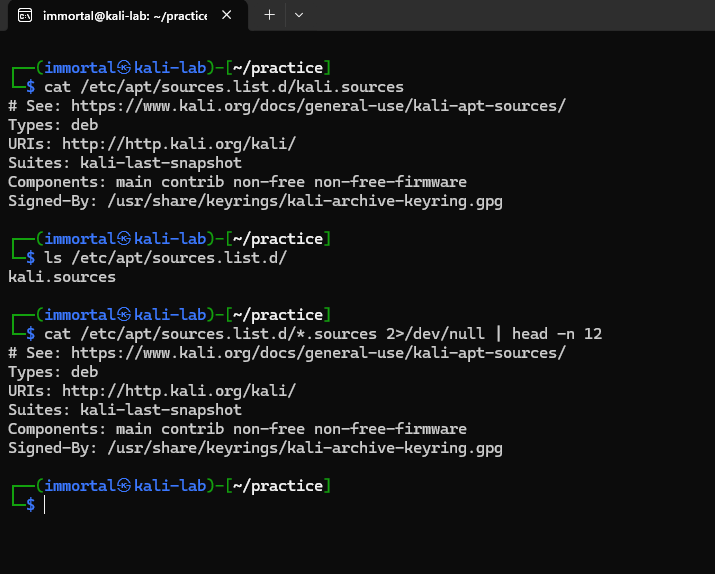

# Linux Notes: Packages and Logs

[Back to Linux index](README.md)

I practiced these commands on Kali Linux in WSL2.

## Package management

On Debian-based systems (Kali, Ubuntu), I use `apt`.

```bash
sudo apt update              # refresh the package list
apt list --upgradable        # show packages that have updates
sudo apt upgrade -y          # upgrade installed packages
sudo apt install tree -y     # install a package
sudo apt remove tree         # remove it (keeps its config files)
sudo apt purge tree          # remove it and its config files
sudo apt autoremove          # remove packages that were installed only as dependencies
apt search nmap | head       # search packages (the full list is long)
apt show nmap                # package details
dpkg -l | grep nmap          # check whether it is installed
sudo apt install ./package.deb   # install a downloaded .deb file and resolve its dependencies
sudo dpkg -i package.deb         # install a .deb file directly (does not automatically resolve dependencies)
```

- `apt update` only refreshes the list of available packages, and `apt upgrade` installs the newer versions.
- `apt` is the friendly command for everyday use, and `dpkg` is the lower-level tool that works on individual `.deb` files.

I searched for a package, installed it, checked it, and removed it:

```bash
apt search '^tree$'
sudo apt install tree -y
tree --version
dpkg -l tree
sudo apt remove tree -y
which tree
echo $?
```




- `apt search '^tree$'` found the package named exactly `tree`. The `^` and `$` match the start and end of the name, so related packages don't clutter the list.
- `apt install tree -y` downloaded and installed it, and `tree --version` confirmed that the command works.
- `dpkg -l tree` listed the package, and its status `ii` means installed.
- After `apt remove`, `which tree` printed nothing, and `echo $?` printed `1`, which means the command was not found.

## apt repositories and third-party software sources

`apt` installs software from **repositories**: servers that hold packages. My system stores repository configuration in:

```bash
cat /etc/apt/sources.list       # older repository configuration file (may not exist)
ls /etc/apt/sources.list.d/     # list additional repository files
```

Newer Kali installations may keep their main repository configuration in a `.sources` file inside `/etc/apt/sources.list.d/`.

On my Kali system, the repository configuration is stored in `kali.sources`:

```bash
cat /etc/apt/sources.list.d/kali.sources
ls /etc/apt/sources.list.d/
cat /etc/apt/sources.list.d/*.sources 2>/dev/null | head -n 12
```



- A one-line entry such as `deb http://http.kali.org/kali kali-rolling main contrib non-free non-free-firmware` has four parts: the type (`deb` for binary packages), the repository URL, the release name (`kali-rolling`), and the components (`main`, `contrib` and so on).
- In the newer `.sources` format, the same information appears as named fields such as `Types`, `URIs`, `Suites`, `Components` and `Signed-By`.
- `Signed-By` points to the GPG key file that APT uses to check the repository's signatures.
- My Kali system uses the `.sources` format. The screenshot shows the actual repository configuration, including its `kali-last-snapshot` suite.

### Adding a third-party repository

Adding a third-party source has three parts:

1. Download the vendor's **GPG signing key**. This lets APT verify that packages are signed by the expected repository key.
2. Add a **source entry** that points to the vendor's repository.
3. Run `sudo apt update`, then install the package.

**Step 1: Save the vendor's key**

The URL and filename below are placeholders. Use the vendor's official instructions.

```bash
sudo apt install gnupg curl -y
sudo mkdir -p /etc/apt/keyrings
curl -fsSL REAL_KEY_URL | sudo gpg --dearmor -o /etc/apt/keyrings/vendor.gpg
```

- `gnupg` provides the `gpg` command, and `curl` downloads files.
- Replace `REAL_KEY_URL` with the actual signing-key URL provided by the software vendor.
- The example command will not work with a placeholder URL.

**Step 2: Add the repository, tied to that key**

```bash
echo "deb [signed-by=/etc/apt/keyrings/vendor.gpg] https://example.com/apt stable main" | sudo tee /etc/apt/sources.list.d/vendor.list
```

This example uses a placeholder repository URL. Replace it with the actual repository address and release information provided by the vendor.

**Step 3: Refresh and install**

```bash
sudo apt update
sudo apt install vendor-package
```

`vendor-package` is also a placeholder. Use the actual package name provided by the vendor.

**PPA (Ubuntu-specific)**

On Ubuntu, a **PPA** (Personal Package Archive) is a shortcut for adding third-party software repositories:

```bash
sudo add-apt-repository ppa:name/ppa
sudo apt update
```

PPAs are primarily an Ubuntu feature. Do not use random Ubuntu PPAs on Kali Linux.

**Removing a third-party repository**

To remove a source, delete its configuration file from `/etc/apt/sources.list.d/` and, if no longer needed, remove its associated key from `/etc/apt/keyrings/`. Then run:

```bash
sudo apt update
```

Security notes:

- Every extra repository can install code with root access, so only add sources I trust, using the vendor's official documentation.
- Older tutorials use `apt-key add`, which is deprecated. Use the `signed-by` method above.
- Do not add random Ubuntu repositories to Kali, because mixing them can break the system. Back up or snapshot first.

## Logs

Logs show what happened on the system. As someone learning offensive security, I read them to understand detection; as a defender, I read them to investigate suspicious activity.

```bash
ls /var/log                       # list available log files
sudo journalctl -b -n 20          # show the latest 20 logs from the current boot
sudo journalctl -xe               # recent logs with explanations
sudo journalctl -u ssh -n 20      # logs for the SSH service (if installed and running)
sudo journalctl -u ssh -f        # follow SSH service logs live (Ctrl+C to stop)
sudo journalctl -f                # follow all new system journal entries
sudo journalctl _COMM=sshd        # show logs from the SSH daemon, if available
last                               # login history, if login records are available
```

On Kali Linux, systemd journal is commonly used for system and service logs. The `journalctl` command lets me read these logs.

In WSL2, `journalctl` requires systemd to be running. To check whether systemd is running:

```bash
ps -p 1 -o comm=
```

If the output is `systemd`, systemd is running as PID 1.

Some systems also have `/var/log/auth.log` and `/var/log/syslog`, but these files may not exist if `rsyslog` is not installed or running.

If `auth.log` exists, I can inspect authentication-related events:

```bash
sudo tail -n 20 /var/log/auth.log
sudo tail -f /var/log/auth.log
sudo grep "Failed password" /var/log/auth.log
```

If these files do not exist, I use `journalctl` instead.

I also practised reading package logs because I had recently installed and removed a package:

```bash
ls /var/log
sudo tail -n 5 /var/log/dpkg.log
sudo grep " install tree" /var/log/dpkg.log
```


- `/var/log` holds log files, and `ls` showed which ones exist on my system. A log such as `auth.log` or `syslog` may not exist if the relevant logging service is not installed or running.
- `journalctl` displays logs collected by systemd. I can filter them by boot, service or process.
- `last` displays login history using available login records.
- `/var/log/dpkg.log` records package management actions with timestamps. The `tail` command showed the most recent entries.
- The `grep " install tree"` line found the moment I installed `tree`, with the date, time and version.
- This is the same idea as reading authentication logs for login activity. Logs are time-ordered records, and `grep` helps find the entries I need.
