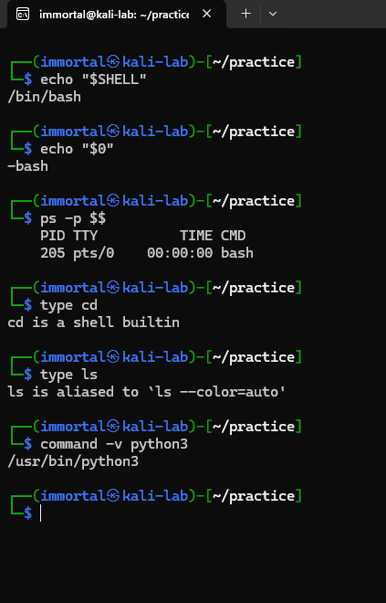
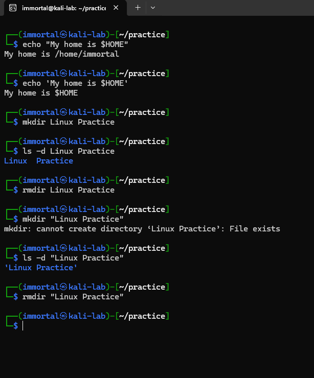
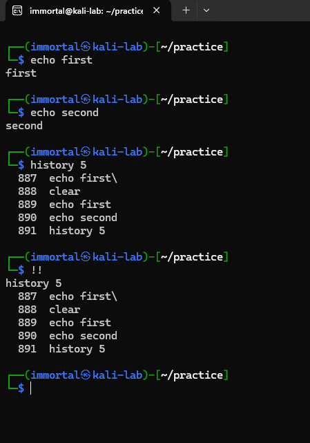
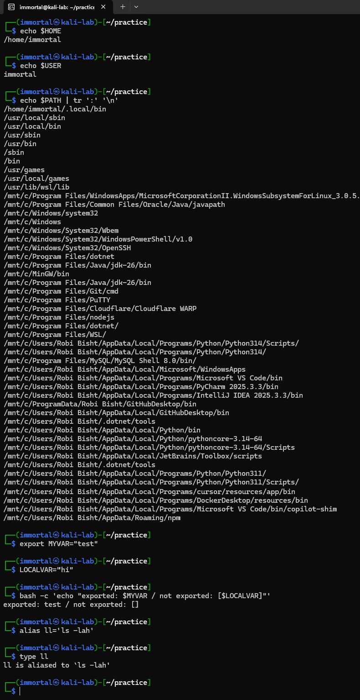
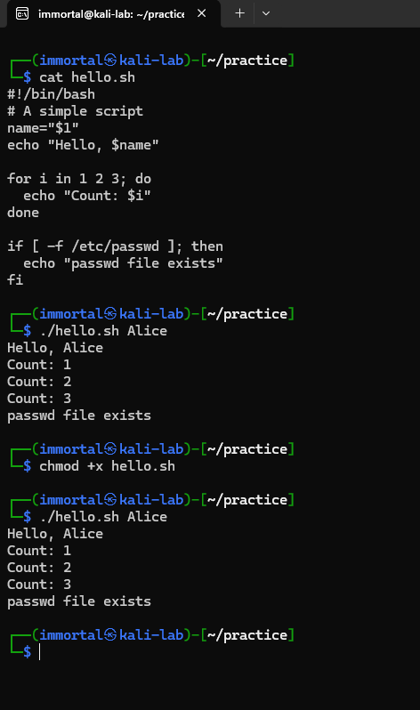
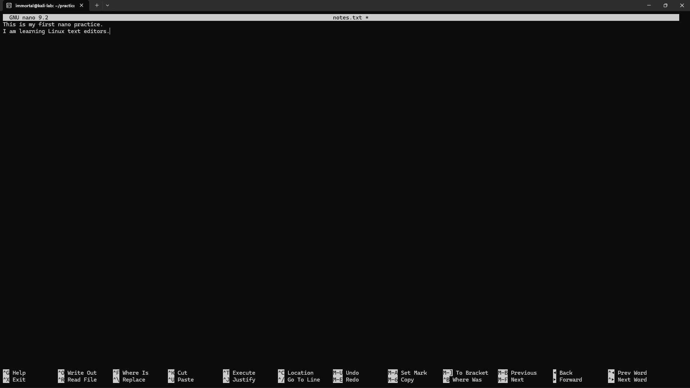
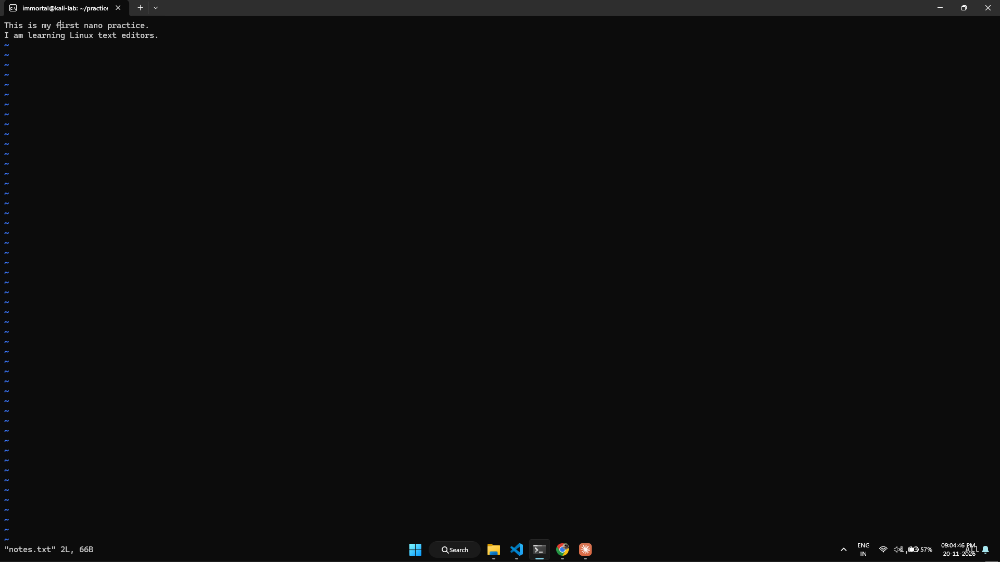
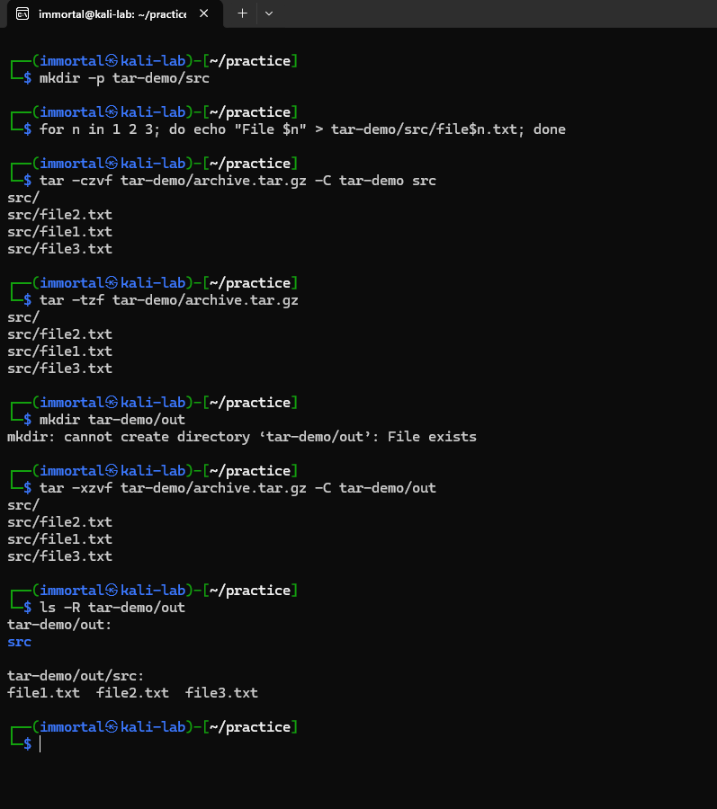

# Linux Notes: Shell, Environment and Scripting

[Back to Linux index](README.md)

I practiced these commands on Kali Linux in WSL2.

## Shell fundamentals

A **shell** is a program that accepts commands from the user, interprets them, and asks the operating system to carry them out. The terminal is the application or window where I interact with the shell.

Bash (Bourne Again Shell) is the default shell on Ubuntu, and newer Kali installs use Zsh by default. Other shells include `sh` and `fish`.

### Checking my current shell

```bash
echo "$SHELL"    # your configured login shell
ps -p $$         # show the shell process running in this terminal
echo "$0"        # often shows the current shell name
cat /etc/shells  # list shells allowed on the system
```

`$SHELL` usually shows my configured login shell. `ps -p $$` checks the process for the shell currently running in this terminal. These values can differ in some situations.

### The shell prompt

A typical Bash prompt may look like this:

```bash
user@kali:~/practice$
```

- `user` is the current username.
- `kali` is the hostname (computer name).
- `~/practice` is the current working directory.
- `$` usually indicates a normal user, and `#` usually indicates a root shell.

### Command types

```bash
type cd             # identify whether cd is a shell builtin, alias, or executable
type ls             # identify the command type for ls
command -v python3  # show how the shell resolves python3
alias               # list aliases for this shell session
```

Some commands, such as `cd`, are shell builtins because they need to change the state of the current shell. Other commands, such as many programs in `/usr/bin`, are separate executable files.

```bash
echo "$SHELL"
echo "$0"
ps -p $$
type cd
type ls
command -v python3
```



- `echo "$SHELL"` showed my configured login shell, and `echo "$0"` and `ps -p $$` showed the shell actually running in this terminal.
- `type cd` reported that `cd` is a shell builtin, because it has to change the directory of the shell itself.
- `type ls` showed that `ls` is an external program (or an alias to it, because Kali defines one with color options).
- `command -v python3` printed the full path that the shell uses to run `python3`.

### Quoting and special characters

Quotes control how the shell interprets spaces and special characters.

```bash
echo "My home is $HOME"         # double quotes allow variable expansion
echo 'My home is $HOME'         # single quotes keep $HOME literal
echo "A file name with spaces"  # double quotes keep the words together
```

Use quotes around paths or filenames that contain spaces:

```bash
cat "my notes.txt"      # read a file whose name contains a space
mkdir "Linux Practice"  # create a directory with a space in its name
```

I compared quoted and unquoted versions:

```bash
echo "My home is $HOME"
echo 'My home is $HOME'
mkdir Linux Practice
ls -d Linux Practice
rmdir Linux Practice
mkdir "Linux Practice"
ls -d "Linux Practice"
rmdir "Linux Practice"
```



- Double quotes expanded `$HOME` into my home directory path. Single quotes printed the text `$HOME` unchanged.
- Without quotes, `mkdir Linux Practice` created **two** directories, `Linux` and `Practice`, because the shell split the text into two arguments.
- With quotes, `mkdir "Linux Practice"` created one directory with a space in its name.
- This is the same problem I met in OverTheWire Bandit with file names that contain spaces.

### Shell startup files

Bash reads configuration files when it starts. These files can set aliases, environment variables and prompt settings. Zsh uses `~/.zshrc` in the same way.

```bash
ls -a ~           # show hidden files in your home directory
nano ~/.bashrc    # edit interactive Bash settings for your user
source ~/.bashrc  # reload ~/.bashrc in the current Bash session
```

Common files:

- `~/.bashrc`: settings for interactive non-login Bash shells.
- `~/.profile`: commonly used for login-session environment settings.
- `/etc/profile`: system-wide login-shell settings.
- `/etc/bash.bashrc`: system-wide Bash interactive settings on Debian-based systems.

Be careful when editing shell startup files: a syntax error can affect future terminal sessions. Keep a backup before making substantial changes, for example `cp ~/.bashrc ~/.bashrc.bak`.

### Shell history

```bash
history     # show commands entered previously
history 10  # show the last 10 history entries
!!          # repeat the previous command
!25         # run history entry number 25
```

History expansion such as `!!` and `!25` is interpreted by the shell. Check a command before repeating it, especially if it uses `sudo` or changes files.

```bash
echo first
echo second
history 5
!!
```



- `history 5` listed the last five commands with their numbers, including `echo first` and `echo second`.
- `!!` printed the previous command (`history 5`) and ran it again.
- A common use is `sudo !!`, which repeats the last command with `sudo` after a "permission denied" error.

## Environment variables and PATH

```bash
echo $HOME
echo $USER
echo $PATH          # folders the shell searches for commands
export MYVAR="test"
echo $MYVAR
env                 # list all variables
alias ll='ls -lah'  # create a shortcut for this session
```

I also looked at the PATH one folder per line, and compared an exported variable with a normal one:

```bash
echo $HOME
echo $USER
echo $PATH | tr ':' '\n'
export MYVAR="test"
LOCALVAR="hi"
bash -c 'echo "exported: $MYVAR / not exported: [$LOCALVAR]"'
alias ll='ls -lah'
type ll
```



- `echo $PATH | tr ':' '\n'` put each folder of the PATH on its own line. The shell searches these folders, in this order, when I type a command name.
- A variable I `export` is passed to child processes. The new `bash -c` process printed `test` for `MYVAR`, but the plain variable `LOCALVAR` came out empty (`[]`).
- `type ll` showed that `ll` is an alias for `ls -lah`. It only lasts for this session unless I put it in `~/.bashrc` (or `~/.zshrc`).

PATH matters for security: if a privileged script runs a command without its full path and I can control PATH, I may be able to run my own program instead. Understanding it now will help me recognize it later in privilege escalation labs.

## Shell scripting basics

I created a file `hello.sh` with nano:

```bash
#!/bin/bash
# A simple script
name="$1"
echo "Hello, $name"

for i in 1 2 3; do
  echo "Count: $i"
done

if [ -f /etc/passwd ]; then
  echo "passwd file exists"
fi
```

Run it. The file has no execute permission when it is new, so the first run fails:

```bash
cat hello.sh
./hello.sh Alice
chmod +x hello.sh
./hello.sh Alice
```



- `cat hello.sh` showed the script I wrote.
- The first `./hello.sh Alice` printed a "permission denied" message, because the file had no execute permission.
- After `chmod +x`, the script ran. `$1` held the first argument (`Alice`), so it printed `Hello, Alice`, counted from 1 to 3, and reported that `/etc/passwd` exists.
- The first line, `#!/bin/bash`, tells the system which program should run the script.

A small recon-style script (a ping sweep). For my own lab network I use its address range. In WSL I tested the loop on loopback addresses, which all answer:

```bash
#!/bin/bash
# Ping sweep for a lab network. Use only on networks you own.
for i in $(seq 1 20); do
  ping -c 1 -W 1 192.168.56.$i &> /dev/null && echo "192.168.56.$i is up"
done
```

## Text editors: nano and Vim

I will edit config files and scripts on machines that have no graphical editor, so I learn both.

**nano (easy):**

```bash
nano notes.txt
```

| Keys | Action |
|---|---|
| `Ctrl + O`, then Enter | Save |
| `Ctrl + X` | Exit |
| `Ctrl + W` | Search |
| `Ctrl + K` / `Ctrl + U` | Cut a line / paste it |

**Vim (powerful, and on almost every server):**

```bash
vim notes.txt
```

Vim has **modes**, and this is what confuses beginners:

- **Normal mode** (default): keys are commands, not text. Press `Esc` to get back here from anywhere.
- **Insert mode:** I type text. Press `i` to enter it.
- **Command mode:** press `:` to type commands like save and quit.

| Keys | Action |
|---|---|
| `i` | Start typing (insert mode) |
| `Esc` | Return to normal mode |
| `:w` | Save |
| `:q` | Quit |
| `:wq` or `ZZ` | Save and quit |
| `:q!` | Quit without saving |
| `dd` | Delete (cut) the current line |
| `yy` then `p` | Copy a line, then paste it |
| `u` | Undo |
| `/word` then Enter | Search for a word (`n` for the next match) |
| `:set number` | Show line numbers |
| `gg` / `G` | Jump to the top / bottom of the file |

A safe way to learn: run `vimtutor` in the terminal. It is a 30-minute interactive lesson built into most Linux systems.




## Compression and archives

```bash
tar -cvf archive.tar folder/      # create a tar archive
tar -czvf archive.tar.gz folder/  # create a compressed archive
tar -tzf archive.tar.gz           # list what is inside without extracting
tar -xvf archive.tar              # extract
tar -xzvf archive.tar.gz          # extract a gzipped archive
tar -xzvf archive.tar.gz -C dest/ # extract into another directory
zip -r archive.zip folder/
unzip archive.zip
```

`zip` and `unzip` may need installing first: `sudo apt install zip unzip -y`. In the tar flags, `c` creates, `x` extracts, `t` lists, `z` uses gzip, `v` is verbose and `f` names the file.

I created a folder with three files, compressed it, listed the archive, and extracted it somewhere else:

```bash
mkdir -p tar-demo/src
for n in 1 2 3; do echo "File $n" > tar-demo/src/file$n.txt; done
tar -czvf tar-demo/archive.tar.gz -C tar-demo src
tar -tzf tar-demo/archive.tar.gz
mkdir tar-demo/out
tar -xzvf tar-demo/archive.tar.gz -C tar-demo/out
ls -R tar-demo/out
```



- `tar -czvf` created `archive.tar.gz` and listed each file as it added it. The `-C tar-demo` made the paths inside the archive start at `src/`.
- `tar -tzf` listed the contents without extracting anything.
- `tar -xzvf ... -C tar-demo/out` extracted the files into another directory, and `ls -R` showed that all three files were recovered.

## Cleaning up

```bash
rm -r tar-demo
rm ~/.bashrc.bak 2>/dev/null
```