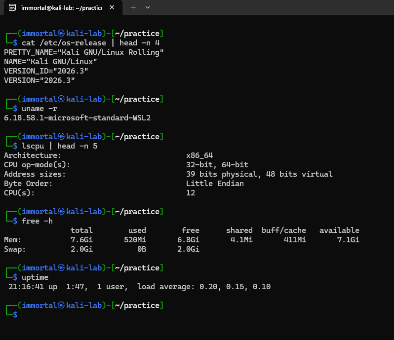
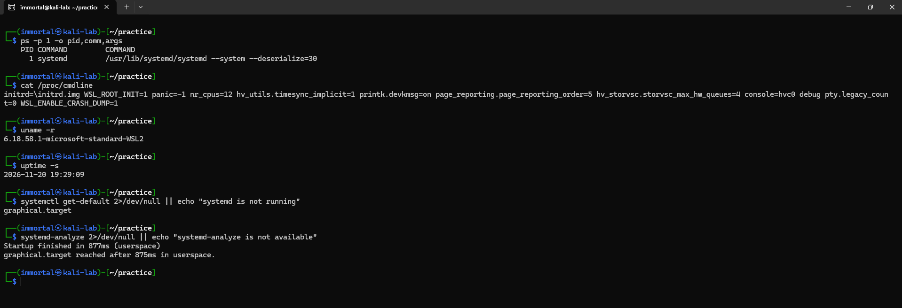
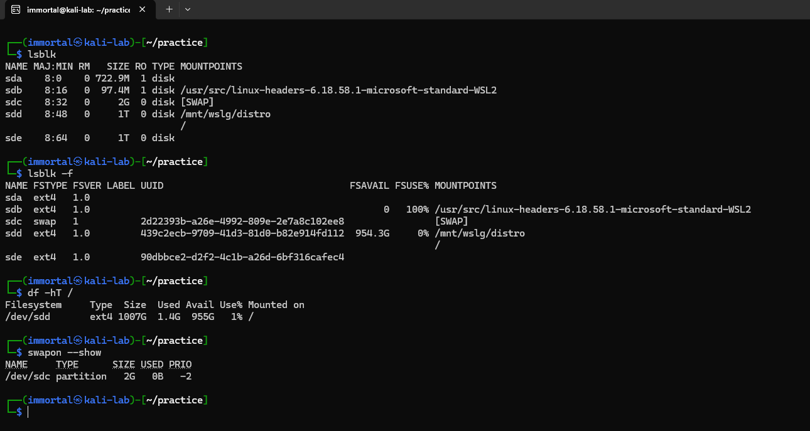
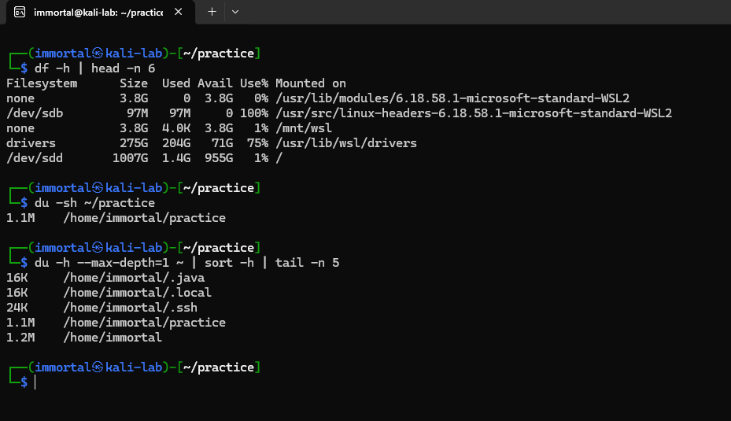
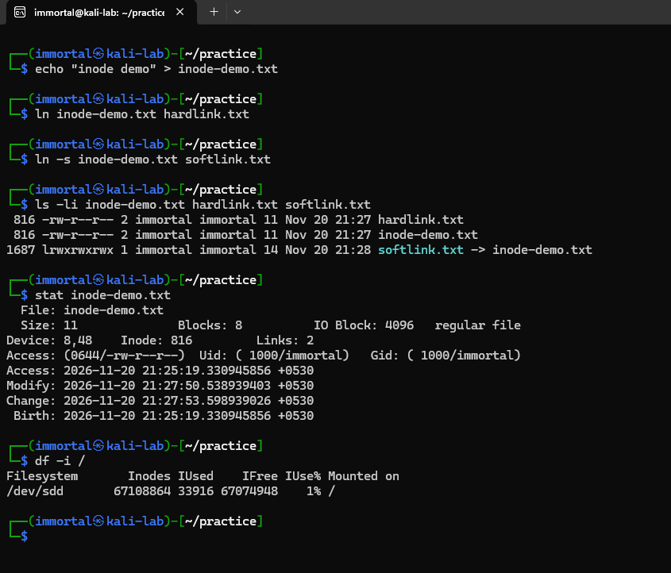

# Linux Notes: System Information, Boot, Disks and File Systems

[Back to Linux index](README.md)

I practiced these commands on Kali Linux in WSL2. WSL is not a normal machine: it has no BIOS or bootloader of its own, and its disks are virtual. Some commands below (`lspci`, `lsusb`, `timedatectl`, `hostnamectl`, `journalctl`, `systemd-analyze`) show little or fail with an error, depending on whether systemd is running. I note this where it matters.

## System information and identification

System information commands help me identify the Linux distribution, kernel, hardware, memory, processor and system uptime. This is useful when troubleshooting, checking VM resources and understanding the machine I am working on.

### Operating system and kernel

```bash
uname                # kernel name
uname -r             # kernel release/version
uname -a             # all available kernel/system information
cat /etc/os-release  # Linux distribution name and version
hostname             # display the computer's hostname
hostnamectl          # show hostname and system information (needs systemd)
```

`uname` reports kernel information, while `/etc/os-release` identifies the Linux distribution. They answer different questions.

### CPU and memory

```bash
lscpu              # CPU architecture, cores, threads, and model
free -h            # RAM and swap usage in human-readable units
cat /proc/cpuinfo  # detailed processor information
cat /proc/meminfo  # detailed memory information
```

### Storage and connected devices

```bash
lsblk     # list disks and partitions
lsblk -f  # show filesystem types, labels, and mount points
lspci     # list PCI devices, such as network and graphics adapters (may need: sudo apt install pciutils)
lsusb     # list USB devices (may need: sudo apt install usbutils)
```

### Uptime and logged-in users

```bash
uptime       # how long the system has been running and load averages
who          # users currently logged in
w            # logged-in users and what they are doing
date         # current system date and time
timedatectl  # time, date, and time-synchronization information (needs systemd)
```

### A quick system-information check

```bash
cat /etc/os-release | head -n 4
uname -r
lscpu | head -n 5
free -h
uptime
```



- `/etc/os-release` showed the distribution name and version (Kali), and `uname -r` showed the kernel release. In WSL the kernel name contains `microsoft` and `WSL2`, because it is a kernel supplied by Windows.
- `lscpu` showed the CPU architecture, the number of CPUs and the model name.
- `free -h` showed total, used and free RAM and swap in human-readable units.
- `uptime` showed how long this WSL session has been running, and the load averages.
- These commands only display information; they do not change system configuration.

## Linux boot process

The **boot process** is the sequence of steps Linux follows when a computer or virtual machine is switched on. Understanding it helps with troubleshooting startup problems and understanding how Linux services begin running.

### Main stages of the boot process

1. **BIOS/UEFI:** Firmware starts first, performs basic hardware checks, and selects a boot device.
2. **Bootloader (usually GRUB):** The bootloader presents or selects a Linux boot entry and loads the kernel and initial RAM filesystem.
3. **Kernel:** The Linux kernel initializes hardware, memory, drivers and core operating-system functions.
4. **Initramfs:** A temporary filesystem used during early startup. It provides tools and drivers needed to locate and mount the real root filesystem.
5. **Init system (usually systemd):** The init system starts and manages system services and brings the machine to its configured target.
6. **Login:** A login screen or text login prompt becomes available.

In WSL, Windows starts a lightweight virtual machine with its own kernel, so steps 1 and 2 don't happen the way they do on a real machine. Steps 3 to 6 still apply in a simplified form.

### Checking boot information

```bash
uptime             # show how long the system has been running
uptime -s          # show when the system started
who -b             # show the last system boot time
last reboot        # show recorded reboot history
uname -r           # show the running kernel version
ls /boot           # list available kernel and boot files
cat /proc/cmdline  # show parameters passed to the running kernel
```

### Understanding systemd startup

On most normal Kali and Ubuntu installations, `systemd` is PID 1 and manages services and system startup. In WSL it may be `init` instead.

```bash
ps -p 1 -o pid,comm,args             # identify process 1
systemctl get-default                # show the default systemd target
systemctl list-units --type=target   # list currently loaded targets
systemctl list-units --type=service  # list loaded services
```

Common systemd targets:

| Target | Purpose |
|---|---|
| `poweroff.target` | Shut down the system |
| `rescue.target` | Minimal rescue environment |
| `multi-user.target` | Multi-user text-based system |
| `graphical.target` | Graphical login and desktop environment |
| `reboot.target` | Reboot the system |

### Viewing boot logs and timing

```bash
journalctl -b          # logs from the current boot
journalctl -b -1       # logs from the previous boot, if available
journalctl -b -p err   # error-priority messages from the current boot
systemd-analyze        # summary of startup time
systemd-analyze blame  # show service initialization times
```

`journalctl -b` is especially useful when investigating startup or service problems. Some commands may show limited information depending on permissions and the system's log retention settings.

I checked what is available in my WSL. The last two lines print a message instead of an error if systemd isn't running:

```bash
ps -p 1 -o pid,comm,args
cat /proc/cmdline
uname -r
uptime -s
systemctl get-default 2>/dev/null || echo "systemd is not running"
systemd-analyze 2>/dev/null || echo "systemd-analyze is not available"
```



- `ps -p 1` identified the first process (PID 1), which starts everything else. In WSL it is `init` unless systemd is enabled.
- `/proc/cmdline` showed the parameters that were passed to the kernel when it started.
- `uptime -s` printed the time when this WSL instance started.
- If systemd isn't running, the last two lines print a message. With systemd, they show the default target and the startup time summary.

## Disk management

Disk management means checking storage devices, partitions, available space and mounted filesystems. A disk is a physical or virtual storage device, and a partition is a defined region of that disk.

**Important:** Commands that create, delete, resize or format partitions can permanently destroy data or make a system unbootable. The examples below focus on inspecting storage. Do not experiment with partition changes on a main system or an important VM disk.

### Viewing disks and partitions

```bash
lsblk          # list disks, partitions, and mount points
lsblk -f       # include filesystem type, UUID, and labels
sudo fdisk -l  # list partition tables on available disks
sudo blkid     # show filesystem types and UUIDs
```

Example `lsblk` output (illustrative):

```text
NAME   SIZE TYPE MOUNTPOINTS
sda     40G disk
|-sda1   1G part /boot
`-sda2  39G part /
```

Here, `sda` is the disk, while `sda1` and `sda2` are partitions. My actual device names and layout will differ.

### Checking free and used space

```bash
df -h                  # free and used space on mounted filesystems
df -T                  # show filesystem type as well
du -sh ~/practice      # total space used by one directory
du -h --max-depth=1 ~  # show space used by each immediate home subdirectory
```

- `df` reports space available on filesystems.
- `du` estimates the space used by files and directories.

I looked at my disks, the root filesystem, and swap:

```bash
lsblk
lsblk -f
df -hT /
swapon --show
```



- `lsblk` listed the virtual disks and their sizes. In WSL these are virtual disks provided by Windows, and the root filesystem sits on one of them.
- `lsblk -f` added the filesystem type (normally `ext4` for the root) and the UUID.
- `df -hT /` showed the type, size, used and available space of the filesystem that holds `/`, and where it is mounted.
- `swapon --show` listed the active swap areas.

Then I compared the usage of the whole filesystem with my own files:

```bash
df -h | head -n 6
du -sh ~/practice
du -h --max-depth=1 ~ | sort -h | tail -n 5
```



- `df -h` shows space per mounted filesystem. In WSL it also lists the Windows drives, mounted under `/mnt`.
- `du -sh ~/practice` printed the total size of my practice directory.
- `du -h --max-depth=1 ~ | sort -h | tail -n 5` listed the five largest items in my home directory. `sort -h` understands sizes like `4.0K` and `1.2G`.
- `df` answers "how full is the disk", and `du` answers "what is using the space".

### Mount points and mounted filesystems

A **mount point** is a directory where a filesystem becomes accessible.

```bash
findmnt           # show mounted filesystems in a tree
findmnt /         # show the filesystem mounted at /
mount             # list currently mounted filesystems
cat /proc/mounts  # show kernel mount information
```

For example, a separate storage device may be made accessible through a directory such as `/mnt/data`. The device must have a suitable filesystem and be mounted before its files can be accessed through that directory.

### Removable storage: mount and unmount

First identify the correct device:

```bash
lsblk -f  # identify the device and its filesystem
```

If I have a suitable, already-formatted practice device and know its correct partition, an administrator can mount it at an existing directory:

```bash
sudo mkdir -p /mnt/usb
sudo mount /dev/sdX1 /mnt/usb  # placeholder: replace with the verified partition
findmnt /mnt/usb               # verify the mount
ls /mnt/usb                    # view its contents
sudo umount /mnt/usb           # unmount before disconnecting the device
```

`/dev/sdX1` is only a placeholder, not a device name to copy blindly. Confirm the device with `lsblk -f` first. Never unplug a mounted storage device without safely unmounting it.

### Swap space

Swap is disk space Linux can use as a backing store for memory pages when needed. It is not a replacement for sufficient RAM.

```bash
swapon --show  # show active swap areas
free -h        # show RAM and swap usage
```

### Disk-management terms

- **Disk:** The complete storage device, such as a virtual disk in VirtualBox.
- **Partition:** A defined section of a disk.
- **Filesystem:** The structure used to organize files and directories on a partition or other storage.
- **Mount point:** The directory through which a filesystem is accessed.
- **UUID:** A filesystem identifier that can be used to refer to a filesystem consistently.

## Linux file systems

A **filesystem** is the method Linux uses to organize, store, name and retrieve files and directories on storage devices. Linux supports several filesystem types.

### Common Linux filesystem types

| Filesystem | Description |
|---|---|
| ext4 | Common general-purpose Linux filesystem; widely used on Ubuntu and Kali installations |
| XFS | Journaling filesystem often used for larger storage workloads |
| Btrfs | Supports features such as snapshots and checksums |
| vfat/FAT32 | Commonly used for removable media and compatibility |
| exFAT | Common on removable storage devices, especially larger flash drives |
| NTFS | Common Windows filesystem; Linux can access it with appropriate support |
| swap | Dedicated swap area; it is not a normal file-storage filesystem |

### Identify a filesystem

```bash
lsblk -f                                   # show filesystem type and mount point for each device
sudo blkid                                 # show filesystem type, UUID, and labels
df -T                                      # show filesystem types for mounted filesystems
sudo file -s "$(findmnt -no SOURCE /)"     # inspect the device that holds the root filesystem
```

`findmnt -no SOURCE /` may return a virtual or overlay source in WSL, so file -s isn't guaranteed to identify the underlying physical storage

### Files, directories and inodes

An **inode** stores metadata about a filesystem object, such as its type, owner, permissions, timestamps and the locations of its data blocks. A filename is stored as a directory entry that refers to an inode.

```bash
ls -i file.txt  # show the inode number of a file
stat file.txt   # show file metadata, including inode and permissions
df -i           # show inode usage on mounted filesystems
```

A filesystem can run out of available inodes even when it still has free storage space. `df -i` helps check inode availability.

Hard links and symbolic links show how inodes work:

```bash
echo "inode demo" > inode-demo.txt
ln inode-demo.txt hardlink.txt
ln -s inode-demo.txt softlink.txt
ls -li inode-demo.txt hardlink.txt softlink.txt
stat inode-demo.txt
df -i /
```



- `ls -li` printed the inode number first on each line. `inode-demo.txt` and `hardlink.txt` have the **same** inode number, because a hard link is just another name for the same data. Their link count (the number after the permissions) is `2`.
- `softlink.txt` has a **different** inode number and shows an arrow to its target. A symbolic link is a small separate file that holds a path.
- `stat` listed the inode, size, permissions, owner and the access, modify and change times of the file.
- `df -i /` showed how many inodes the root filesystem has, how many are used and how many are free.

### Linux directory structure and filesystems

Linux presents filesystems through one directory tree beginning at `/` (root). A separate partition or storage device can be mounted at a directory within that tree.

Examples:

- `/`: root of the directory tree.
- `/home`: commonly contains users' home directories.
- `/boot`: boot-related files.
- `/mnt`: commonly used as a temporary mount point for filesystems.
- `/media`: commonly used for removable media.
- `/etc/fstab`: configuration file describing filesystems that should be mounted.

### Viewing filesystem information

```bash
findmnt          # display mounted filesystems
findmnt -t ext4  # display mounted ext4 filesystems
df -hT           # show space and filesystem type
cat /etc/fstab   # view configured filesystem mount entries
```

### Understanding /etc/fstab

`/etc/fstab` is a configuration file that describes filesystems and how they should be mounted. Entries commonly contain:

1. Device or filesystem identifier (often a UUID).
2. Mount point.
3. Filesystem type.
4. Mount options.
5. Dump setting.
6. Filesystem-check order.

Example format (illustrative only):

```text
UUID=xxxx-xxxx  /data  ext4  defaults  0  2
```

Do not copy this placeholder entry into my system. Incorrect `/etc/fstab` entries can cause boot or mounting problems. Read the file first and make a backup before editing it. In WSL, this file is usually short or nearly empty, because WSL mounts the root filesystem and the Windows drives itself.

### Filesystem checks

```bash
findmnt  # identify where a filesystem is mounted
df -h    # check available space
df -i    # check inode availability
```

Filesystem repair tools can modify filesystem metadata. They should only be used with the correct device identified and according to the filesystem's documentation; do not run repair operations on a mounted filesystem unless the tool explicitly supports that operation.

## Cleaning up

```bash
rm inode-demo.txt hardlink.txt softlink.txt
```