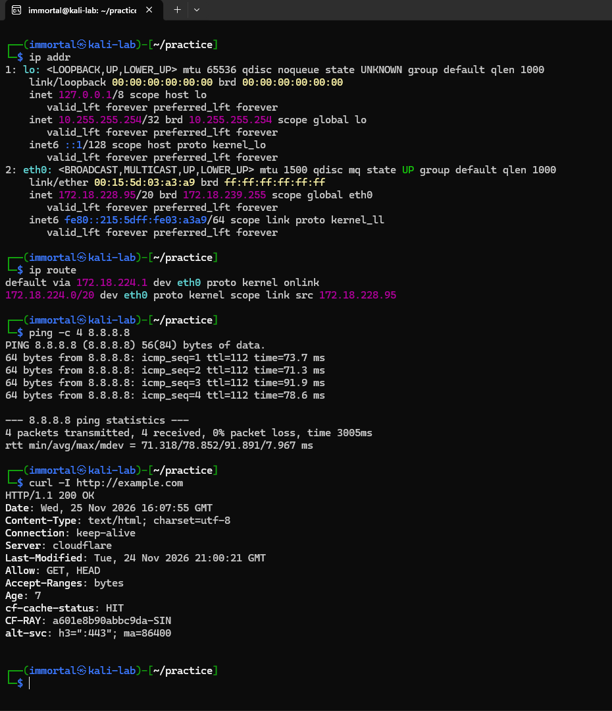

# Models and Layers

[Back to networking index](README.md)

I ran the commands in this file on Kali Linux (WSL2) and on Windows.

## OSI model (7 layers)

| Sr no. | Layer | Job | PDU | Examples / Devices |
|---|---|---|---|---|
| 7 | Application | Interface for apps and network services | Data | HTTP, HTTPS, FTP, SMTP, DNS, SSH |
| 6 | Presentation | Encoding, encryption, compression | Data | TLS/SSL, JPEG, ASCII, UTF-8 |
| 5 | Session | Opens, manages and closes sessions | Data | NetBIOS, RPC, SQL sessions |
| 4 | Transport | End-to-end delivery, ports, reliability | Segment / Datagram | TCP, UDP |
| 3 | Network | Logical addressing and routing | Packet | IP, ICMP, routers |
| 2 | Data Link | Hop-to-hop delivery using MAC addresses | Frame | Ethernet, Wi-Fi, ARP, switches |
| 1 | Physical | Bits on the wire or radio | Bits | Cables, hubs, NIC, radio signals |

## TCP/IP model (4 layers)

| TCP/IP layer | Matches OSI | Protocols |
|---|---|---|
| Application | 5, 6, 7 | HTTP, HTTPS, DNS, DHCP, FTP, SSH, SMTP, Telnet |
| Transport | 4 | TCP, UDP |
| Internet | 3 | IP, ICMP, ARP (sits between layers 2 and 3) |
| Network Access (Link) | 1, 2 | Ethernet, Wi-Fi, MAC addressing |

## Encapsulation: what happens when you open a website

When you type `http://example.com`, my computer first uses DNS to find the server's IP address, then completes a TCP handshake, and only then sends the HTTP request. The data travels down the layers on my machine, and each layer wraps it with its own header. This is **encapsulation**. The receiver unwraps it going up, which is **de-encapsulation**.

```
Application : GET /index.html HTTP/1.1                                 -> DATA
Transport   : [TCP hdr: src port 51522, dst port 80] + DATA            -> SEGMENT
Network     : [IP hdr: src 192.168.1.10, dst 203.0.113.10] + SEGMENT   -> PACKET
Data Link   : [Eth hdr: src MAC, dst MAC (gateway)] + PACKET + [FCS]   -> FRAME
Physical    : 10101101000110...                                        -> BITS
```

The destination MAC is the **gateway's** MAC, not the website's. MAC addresses change at every hop, while IP addresses stay the same from end to end, except when NAT rewrites the private source address on my router.

## Worked examples

### Example 1: Map real tools to layers

| Tool / event | Layer | Why |
|---|---|---|
| `ping` | 3 (Network) | Uses ICMP, which rides on IP |
| `nmap -sS` | 4 (Transport) | Crafts TCP SYN packets to ports |
| Wireshark filter `eth.addr` | 2 (Data Link) | Filters on MAC addresses |
| Burp Suite / SQL injection | 7 (Application) | Manipulates HTTP requests |
| A cut Ethernet cable | 1 (Physical) | Signal path is broken |
| HTTPS encryption | 6 (Presentation) | TLS encrypts and encodes data (the textbook OSI mapping) |

### Example 2: Troubleshoot using layers (bottom-up)

- **Layer 1:** Is the cable plugged in? Is the Wi-Fi connected? Is the link light on?
- **Layer 2:** Does the device have a MAC visible in `arp -a`? Is it on the right VLAN?
- **Layer 3:** Do I have an IP? Can I ping `127.0.0.1`, then the gateway, then `8.8.8.8`?
- **Layer 4:** Is the port open? Use `nc -vz host 443` or `nmap -p 443 host`.
- **Layer 7:** Does the website itself respond? Use `curl -I https://example.com`.

### Practical 1: See the layers on my own machine

Windows:

```
ipconfig /all          # Layer 3 (IP) and Layer 2 (MAC = Physical Address)
ping 8.8.8.8           # Layer 3 test (ICMP)
tracert google.com     # Layer 3 path
```

Linux / Kali:

```
ip addr                      # IP + MAC
ip route                     # default gateway
ping -c 4 8.8.8.8
traceroute google.com
curl -I http://example.com   # Layer 7 response headers
```

`traceroute` may need installing first: `sudo apt install traceroute -y`.

**Task:** Run `ping 8.8.8.8` while Wireshark captures. Expand one packet and identify the Ethernet, IP and ICMP headers. This is the layer stack in action. I did this part in [Wireshark captures explained](05-wireshark-captures-explained.md), Capture 1.

I ran these commands in Kali (WSL2):

```bash
ip addr
ip route
ping -c 4 8.8.8.8
curl -I http://example.com
```



- `ip addr` shows two layers at once: the `link/ether` line is the **MAC address** (Layer 2), and the `inet` line is the **IP address** (Layer 3).
- `ip route` shows the **default gateway**, the router my packets are sent to when the destination is not on my own network. At Layer 2 the frame is addressed to the gateway's MAC address.
- `ping` works at Layer 3. Each reply shows the TTL and the round-trip time, and the summary shows packet loss.
- `curl -I` works at Layer 7. It printed the HTTP status line and the response headers, so it proves that the whole stack below it works.
- Going from the bottom up is the same method as the troubleshooting list above.