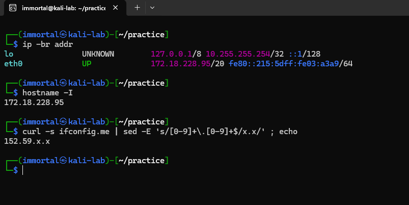
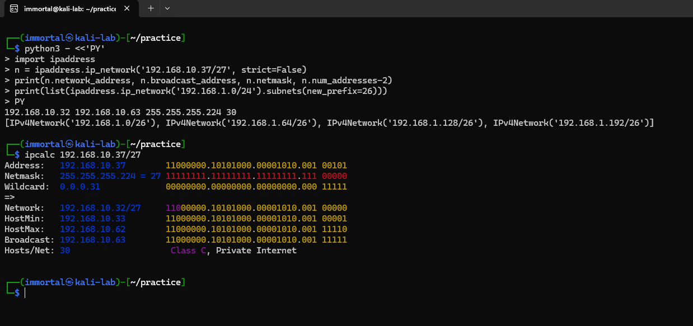

# IP Addressing and Subnetting

[Back to networking index](README.md)

I ran the commands in this file on Kali Linux (WSL2).

## IP addressing

An IP address is the logical address of a device on a network, like a postal address. It has a **network part** (which street) and a **host part** (which house).

### IPv4 basics

- 32 bits, written as four octets in dotted decimal: `192.168.1.10`
- Each octet is 0 to 255 (8 bits), which gives about 4.3 billion addresses in total
- The subnet mask says which bits are network and which are host: `255.255.255.0` = `/24`

Binary view of `192.168.1.10`:

```
192      168      1        10
11000000.10101000.00000001.00001010
```

### Classes (historical)

| Class | First octet | Default mask | Use |
|---|---|---|---|
| A | 1 to 126 | 255.0.0.0 (/8) | Very large networks |
| B | 128 to 191 | 255.255.0.0 (/16) | Medium networks |
| C | 192 to 223 | 255.255.255.0 (/24) | Small networks |
| D | 224 to 239 | n/a | Multicast |
| E | 240 to 255 | n/a | Experimental |

Today networks use **CIDR** (Classless Inter-Domain Routing, for example `/26`), but exam questions still ask about classes. The first octet 127 is skipped in Class A because it is reserved for loopback.

### Private, public and special addresses

| Range | CIDR | Meaning |
|---|---|---|
| 10.0.0.0 to 10.255.255.255 | 10.0.0.0/8 | Private (RFC 1918) |
| 172.16.0.0 to 172.31.255.255 | 172.16.0.0/12 | Private (RFC 1918) |
| 192.168.0.0 to 192.168.255.255 | 192.168.0.0/16 | Private (RFC 1918) |
| 127.0.0.0 to 127.255.255.255 | 127.0.0.0/8 | Loopback (localhost) |
| 169.254.0.0 to 169.254.255.255 | 169.254.0.0/16 | APIPA: self-assigned when DHCP fails |
| 224.0.0.0 to 239.255.255.255 | 224.0.0.0/4 | Multicast |
| 255.255.255.255 | /32 | Limited broadcast |

Private addresses are not routed on the Internet. My router uses **NAT** (see [Core protocols](03-core-protocols.md)) to share one public address among many private devices.

### IPv6 in brief

- 128 bits in hexadecimal: `2001:0db8:85a3:0000:0000:8a2e:0370:7334`
- Shorten it by dropping leading zeros and replacing one run of zero groups with `::`, which gives `2001:db8:85a3::8a2e:370:7334`
- `::1` is loopback, `fe80::/10` is link-local, and `fc00::/7` is unique local (private)
- No broadcast and no ARP in IPv6. It uses multicast and **NDP** (Neighbor Discovery Protocol)

### Examples

#### Example 1: Public or private?

| Address | Answer |
|---|---|
| 172.20.5.9 | Private (inside 172.16 to 172.31) |
| 172.32.0.1 | Public (just outside the private range) |
| 192.169.1.1 | Public (private is 192.168 only) |
| 169.254.12.8 | APIPA: the machine could not reach a DHCP server |
| 127.0.0.5 | Loopback (the whole 127/8 block loops back) |

#### Example 2: Find the class and default mask

- `10.4.7.2`: Class A, mask 255.0.0.0
- `150.30.1.1`: Class B, mask 255.255.0.0
- `200.5.5.5`: Class C, mask 255.255.255.0

#### Practical 2: Inspect addresses

Windows:

```
ipconfig
```

Linux / Kali:

```
ip -br addr
hostname -I
```

My public IP (shows the NAT router's address, not my private one):

```
curl ifconfig.me
```

**Task:** Compare my private IP (`ip addr`) with my public IP (`curl ifconfig.me`). They differ because of NAT.

```bash
ip -br addr
hostname -I
curl -s ifconfig.me | sed -E 's/[0-9]+\.[0-9]+$/x.x/' ; echo
```



- `ip -br addr` lists my interfaces in short form. `lo` has the loopback address `127.0.0.1`, and the other interface has a **private** address (inside one of the private ranges in the table above).
- `hostname -I` prints only my machine's addresses.
- `curl -s ifconfig.me` printed my **public** address, which is different from every address above. It is the address of my Internet connection, and my router uses NAT to share it between all my devices.
- I hide the last two parts of my public address with `sed` before it is printed, because the full address identifies my connection.

## Subnetting

Subnetting splits one large network into smaller ones. Benefits: less broadcast traffic, better organisation, and security, because I can separate servers, staff and guests and apply firewall rules between them.

### The core formulas

| Item | Formula |
|---|---|
| Host bits (h) | 32 minus the prefix length |
| Usable hosts per subnet | `2^h - 2` (minus the network and broadcast addresses) |
| Number of subnets | `2^s`, where s = borrowed bits |
| Block size (increment) | 256 minus the interesting octet of the mask |
| Network address | All host bits = 0 |
| Broadcast address | All host bits = 1 |
| Usable range | Network + 1 up to Broadcast - 1 |

The `2^h - 2` rule doesn't apply to `/31` (used for point-to-point links) and `/32` (a single host).

### Cheat table (last octet)

| CIDR | Mask | Block size | Usable hosts |
|---|---|---|---|
| /24 | 255.255.255.0 | 256 | 254 |
| /25 | 255.255.255.128 | 128 | 126 |
| /26 | 255.255.255.192 | 64 | 62 |
| /27 | 255.255.255.224 | 32 | 30 |
| /28 | 255.255.255.240 | 16 | 14 |
| /29 | 255.255.255.248 | 8 | 6 |
| /30 | 255.255.255.252 | 4 | 2 |

### Step-by-step examples

#### Example 1: Analyse 192.168.10.37/27

1. `/27` gives mask 255.255.255.224, and block size = 256 - 224 = 32.
2. Subnet blocks in the last octet: 0, 32, 64, 96, and so on.
3. 37 falls in the block starting at 32.

```
Network address : 192.168.10.32
First host      : 192.168.10.33
Last host       : 192.168.10.62
Broadcast       : 192.168.10.63
Usable hosts    : 2^5 - 2 = 30
```

#### Example 2: Split 192.168.1.0/24 into 4 equal subnets

I need 4 subnets, so I borrow 2 bits. The new prefix is `/26` (block size 64, 62 hosts each).

| Subnet | Network | Usable range | Broadcast |
|---|---|---|---|
| 1 | 192.168.1.0/26 | 192.168.1.1 to .62 | 192.168.1.63 |
| 2 | 192.168.1.64/26 | 192.168.1.65 to .126 | 192.168.1.127 |
| 3 | 192.168.1.128/26 | 192.168.1.129 to .190 | 192.168.1.191 |
| 4 | 192.168.1.192/26 | 192.168.1.193 to .254 | 192.168.1.255 |

#### Example 3: How many hosts? Pick the right prefix

- Need 100 hosts: `2^7 - 2 = 126`, so 7 host bits, which gives `/25`.
- Need 20 hosts: `2^5 - 2 = 30`, so 5 host bits, which gives `/27`.
- Need 2 hosts (a router link): 2 host bits, which gives `/30`.

#### Example 4: Are two hosts on the same subnet?

Host A = `10.1.1.130/26` and Host B = `10.1.1.190/26`. The block size is 64, so A is in the 128 to 191 block and B is in the 128 to 191 block. They are on the **same subnet**.

If B were `10.1.1.200`, it would be in the 192 to 255 block, a different subnet, so traffic would have to go through a router.

#### Example 5: VLSM (different sizes) for 192.168.5.0/24

Requirements: Servers 50 hosts, Staff 25 hosts, Guests 10 hosts, Router link 2 hosts. **Always allocate the largest segment first.**

| Segment | Needs | Prefix | Network | Range |
|---|---|---|---|---|
| Servers | 50 | /26 (62 hosts) | 192.168.5.0/26 | .1 to .62 |
| Staff | 25 | /27 (30 hosts) | 192.168.5.64/27 | .65 to .94 |
| Guests | 10 | /28 (14 hosts) | 192.168.5.96/28 | .97 to .110 |
| Router link | 2 | /30 (2 hosts) | 192.168.5.112/30 | .113 to .114 |

#### Practical 3: Verify with tools

Python (run it in Kali, Ubuntu or Git Bash):

```
python3 - <<'PY'
import ipaddress
n = ipaddress.ip_network('192.168.10.37/27', strict=False)
print(n.network_address, n.broadcast_address, n.netmask, n.num_addresses-2)
print(list(ipaddress.ip_network('192.168.1.0/24').subnets(new_prefix=26)))
PY
```

Linux: `ipcalc` (install it first with `sudo apt install ipcalc`):

```
ipcalc 192.168.10.37/27
```



- The Python script printed the network address `192.168.10.32`, the broadcast address `192.168.10.63`, the mask `255.255.255.224` and 30 usable hosts, which matches my hand calculation above.
- The second line of Python listed the four `/26` subnets of `192.168.1.0/24`.
- `ipcalc` agreed: network `192.168.10.32/27`, usable hosts from `.33` to `.62`, broadcast `.63`.
- Checking my own answers with a tool is how I find mistakes in my method, such as using the wrong block size.

**Task:** Subnet `172.16.0.0/16` into subnets of 500 hosts each.

**Answer:** 500 hosts need 9 host bits (`2^9 - 2 = 510`), so the prefix is `/23`. The subnets are `172.16.0.0/23`, `172.16.2.0/23`, `172.16.4.0/23`, and so on.

## Practice problems

I solve these by hand first, then check them with Python or `ipcalc`.

1. **Analyse `10.20.30.77/28`.** Find the network address, the usable range, the broadcast address and the number of usable hosts.
2. **Split `172.16.5.0/24` into 8 equal subnets.** What is the new prefix, how many hosts does each subnet have, and what are the first three subnets?
3. **VLSM for `192.168.50.0/24`:** Sales needs 60 hosts, Dev 28, Guests 12 and a router link 2. Allocate the largest first.
4. **Same subnet?** Are `192.168.20.70/27` and `192.168.20.100/27` on the same subnet?

### Answers

1. `/28` has a block size of 16 and 14 usable hosts. 77 falls in the block that starts at 64. Network `10.20.30.64`, usable range `10.20.30.65` to `10.20.30.78`, broadcast `10.20.30.79`.
2. 8 subnets need 3 borrowed bits, so the prefix is `/27` (block size 32, 30 hosts each). The first three subnets are `172.16.5.0/27` (hosts `.1` to `.30`, broadcast `.31`), `172.16.5.32/27` (`.33` to `.62`, broadcast `.63`) and `172.16.5.64/27` (`.65` to `.94`, broadcast `.95`).
3. Largest first:

| Segment | Needs | Prefix | Network | Usable range |
|---|---|---|---|---|
| Sales | 60 | /26 (62 hosts) | 192.168.50.0/26 | .1 to .62 |
| Dev | 28 | /27 (30 hosts) | 192.168.50.64/27 | .65 to .94 |
| Guests | 12 | /28 (14 hosts) | 192.168.50.96/28 | .97 to .110 |
| Router link | 2 | /30 (2 hosts) | 192.168.50.112/30 | .113 to .114 |

4. The block size is 32. `.70` is in the block `.64` to `.95`, and `.100` is in the block `.96` to `.127`. They are in different subnets, so their traffic has to go through a router.

Check with Python:

```bash
python3 - <<'PY'
import ipaddress
print(ipaddress.ip_network('10.20.30.77/28', strict=False))
print(ipaddress.ip_interface('192.168.20.70/27').network, ipaddress.ip_interface('192.168.20.100/27').network)
PY
```