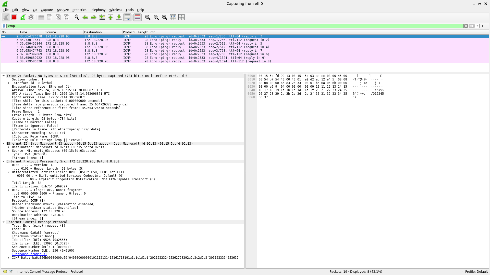
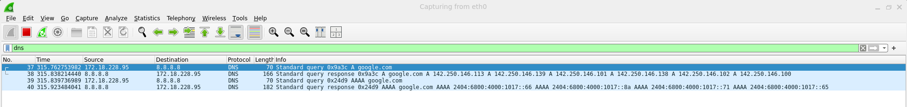

# Packet Analysis with Wireshark

[Back to networking index](README.md)

Wireshark is a packet analyser. It captures traffic on a network interface and shows every layer of every packet. It is essential for troubleshooting, malware analysis, incident response and learning how protocols really behave. I only capture traffic on my own lab network or on networks I have permission to monitor.

## Setting up

- **Install:** on Windows, download from wireshark.org (include Npcap, and the loopback adapter option). I used Wireshark on Windows for most captures, and Wireshark in Kali (a Linux app that runs through WSLg) for the screenshots in this file, capturing on `eth0`. On Kali or Ubuntu (including WSL), the command-line version is `sudo apt install tshark -y`, and the GUI is `sudo apt install wireshark`.
- **Capturing WSL traffic:** the traffic of my WSL2 Kali passes through a virtual interface on Windows, named `vEthernet (WSL)` (the exact name can differ). I capture on that interface to see it. Windows' own Internet traffic uses my Wi-Fi or Ethernet interface, and traffic from Windows to itself (`127.0.0.1`) uses the Npcap loopback adapter.
- **Capturing without root on Linux:** add my user to the `wireshark` group with `sudo usermod -aG wireshark $USER`, then log out and back in.
- **Start a capture:** open Wireshark, pick the active interface (the one with a moving graph), and click the blue shark fin.
- **Stop and save:** click the red square, then save the capture as `.pcapng`.

## The three panes

| Pane | Shows |
|---|---|
| Packet List (top) | One line per packet: No., Time, Source, Destination, Protocol, Length, Info |
| Packet Details (middle) | Expandable tree of layers: Frame, Ethernet, IP, TCP or UDP, then the application |
| Packet Bytes (bottom) | Raw hex and ASCII of the selected packet |

- The top pane lists the packets. I captured on `eth0` in Kali while I ran `ping -c 4 8.8.8.8`, and I selected one ICMP echo request.
- The middle pane shows the layers of that packet as a tree: Frame, Ethernet II, Internet Protocol (IPv4) and ICMP. Expanding a layer shows its fields, for example the TTL under IPv4.
- The bottom pane shows the same packet as raw bytes. Clicking a field in the middle pane highlights its bytes here, which shows exactly where each field sits.

## Capture filters vs display filters

| | Capture filter | Display filter |
|---|---|---|
| When applied | Before capture (limits what is recorded) | After capture (hides rows) |
| Syntax | BPF: `host 192.168.1.1`, `port 80` | Wireshark: `ip.addr == 192.168.1.1` |
| Can be changed live? | No | Yes, at any time |

## Essential display filters

| Goal | Filter |
|---|---|
| Traffic to or from one host | `ip.addr == 192.168.1.10` |
| Source only, destination only | `ip.src == 192.168.1.10`, `ip.dst == 8.8.8.8` |
| A protocol | `dns`, `http`, `arp`, `icmp`, `tcp`, `udp`, `tls` |
| A port | `tcp.port == 443`, `udp.port == 53` |
| Only SYN packets (start of connections) | `tcp.flags.syn == 1 && tcp.flags.ack == 0` |
| Resets | `tcp.flags.reset == 1` |
| HTTP GET and POST | `http.request.method == "GET"`, `http.request.method == "POST"` |
| Text anywhere in a packet | `frame contains "password"` |
| DNS for a name | `dns.qry.name contains "example"` |
| ICMP echo only | `icmp.type == 8 \|\| icmp.type == 0` |
| Combine or negate | `&&`, `\|\|`, `!(arp)`; for example `ip.addr == 10.0.0.5 && !dns` |
| TCP problems | `tcp.analysis.retransmission`, `tcp.analysis.flags` |
| MAC address | `eth.addr == aa:bb:cc:dd:ee:ff` |

A green filter bar means the syntax is valid, and red means a mistake.

- I captured on `eth0` while I ran a lookup, and I typed `dns` in the display filter bar. It turned green, so the filter is valid, and the packet list showed only DNS packets after I pressed Enter.
- An unfinished filter such as `dns ==` turns the bar red until I complete it.
- Display filters only hide rows. The other packets are still in the capture, and clearing the filter shows them again. (In the table, the `\|\|` is how I write `||` so the table doesn't break. In Wireshark I type `||`.)

## Practical exercises

I did these practicals and documented each one, with screenshots, in [Wireshark captures explained](05-wireshark-captures-explained.md).

### Practical 14: Capture a ping (ICMP)

1. Start capturing and apply the filter `icmp`.
2. In a terminal run `ping -c 4 8.8.8.8`.
3. I should see 4 Echo requests and 4 replies. Expand a packet to see Ethernet, IPv4 (note the TTL) and ICMP type 8 or 0.

### Practical 15: Capture a TCP three-way handshake

1. Filter: `tcp.port == 80`. In a terminal run `curl http://example.com`.
2. Find the first three packets: `[SYN]`, `[SYN, ACK]`, `[ACK]`.
3. Click the SYN packet, expand TCP, and look at the flags and the sequence number. Check that the ack of the SYN-ACK equals my seq + 1. Wireshark shows **relative** sequence numbers by default (starting at 0), so the numbers I see are small.
4. Right-click any packet, then choose Follow, then TCP Stream, to read the HTTP request and response.

### Practical 16: Capture a DNS lookup

1. Filter: `dns`. Run `nslookup example.com`.
2. Find the query (type A) and the response. Check the Answers section and the TTL.

### Practical 17: Why clear-text protocols are dangerous

Use only an intentionally vulnerable lab target or my own test server. I used my own test server on Windows (PowerShell): `python -m http.server 8000 --bind 127.0.0.1`, captured on the Npcap loopback adapter, and sent a fake login with `curl.exe -d "username=testuser&password=not-a-real-password" http://127.0.0.1:8000/login`. The server answers with an error because it cannot handle POST requests, but the request still travels in plain text, which is all this exercise needs.

1. Filter: `http.request.method == "POST"` while logging in to the test site over HTTP.
2. Open the packet and look at the HTML Form URL Encoded section. The username and password are visible in plain text.
3. Repeat the login over HTTPS and note that I only see encrypted TLS Application Data.

### Practical 18: Spot an Nmap SYN scan in my capture

1. Capture on my lab interface while running `sudo nmap -sS <lab target>` against my own lab machine. In my setup I capture on the `vEthernet (WSL)` interface and scan the gateway address that `ip route` shows in WSL. That address is my own Windows machine.
2. Use the filter `tcp.flags.syn == 1 && tcp.flags.ack == 0`. I will see hundreds of SYNs from one source to many different ports.
3. Open Statistics, then Conversations, then the TCP tab, to see them all. Many conversations with tiny packets and RSTs signal a scan.

## Useful Wireshark features

- **Statistics > Protocol Hierarchy:** the percentage of each protocol; unusual protocols stand out.
- **Statistics > Conversations and Endpoints:** who talks to whom and how much.
- **Analyze > Expert Information:** warnings such as retransmissions, resets and duplicate IPs.
- **File > Export Objects > HTTP:** extract files transferred over HTTP. In malware analysis, always do this in an isolated VM.
- **Colouring rules (default theme):** black rows with red text mean TCP problems, light blue is UDP and DNS, light green is HTTP, and pale yellow is ARP.
- **tshark** is the command-line version: `tshark -i eth0 -f "port 53" -c 20` and `tshark -r file.pcapng -Y "http"`.
- **Decrypting HTTPS** is only possible with the session keys (the `SSLKEYLOGFILE` setting), because the traffic is encrypted.