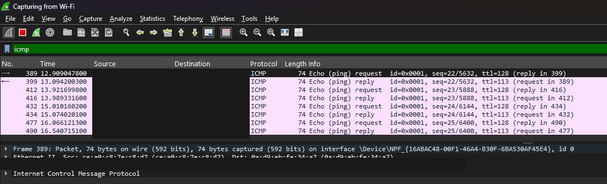
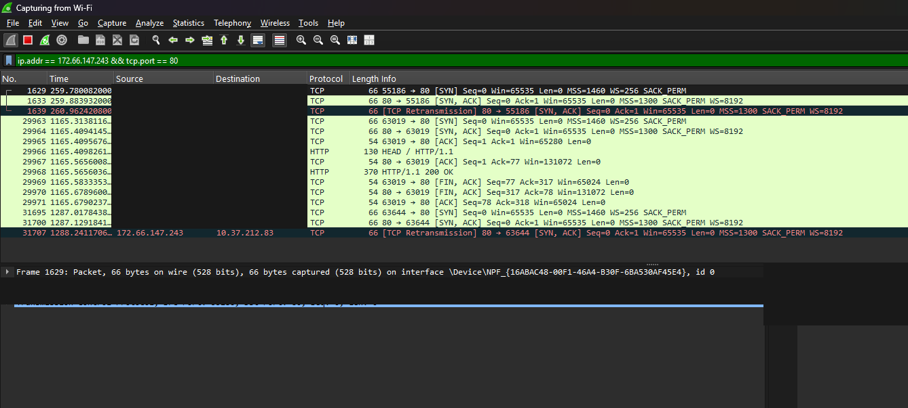
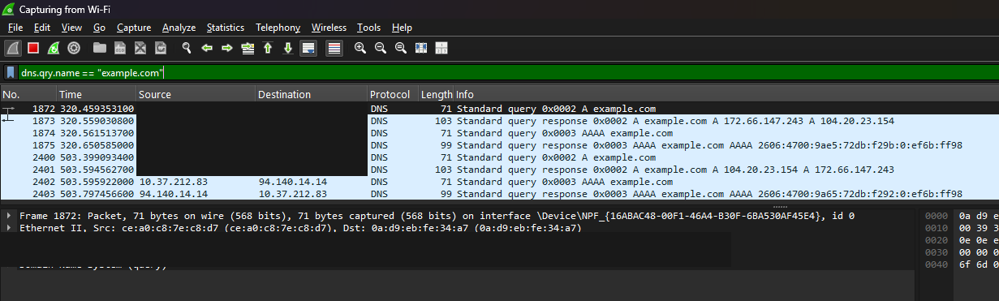
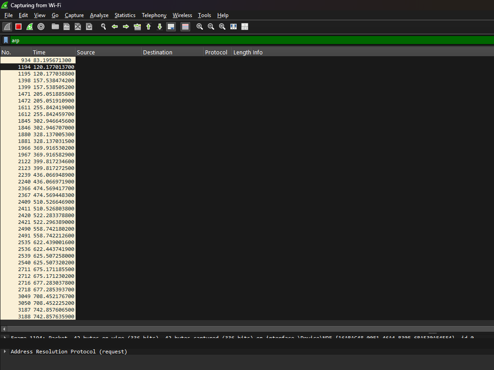
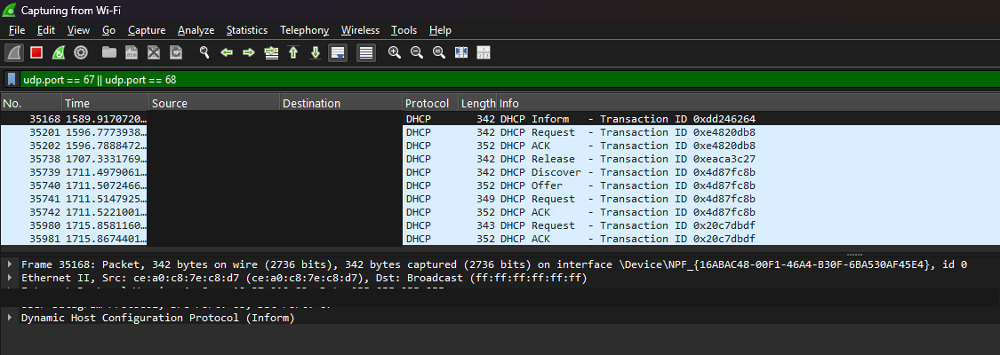
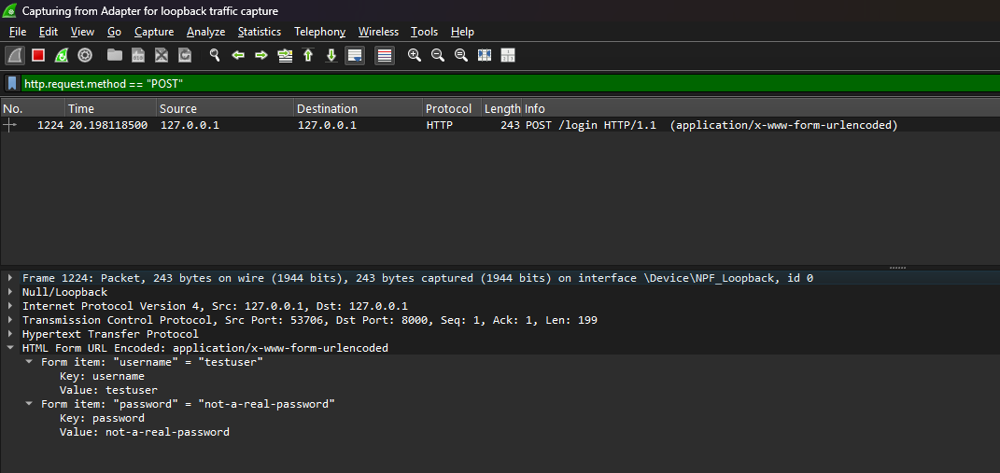
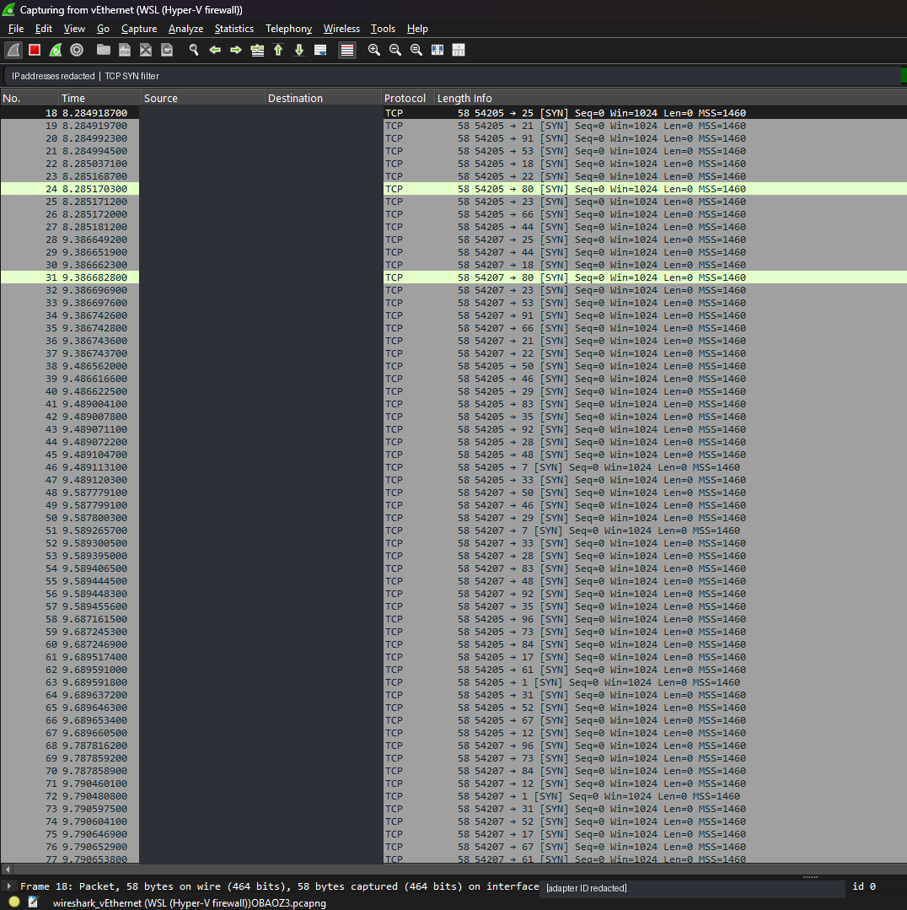
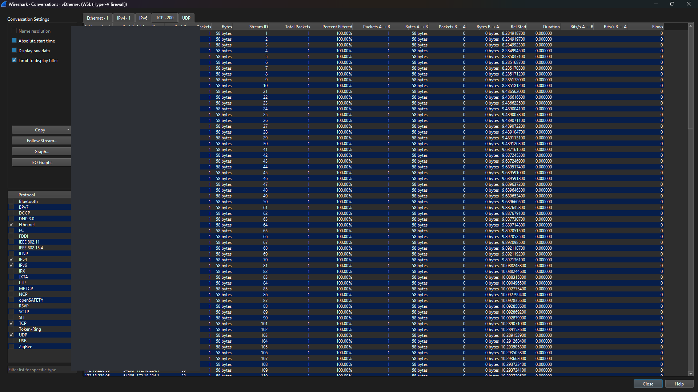

# Wireshark Captures Explained

[Back to networking index](README.md) | [Wireshark notes](04-wireshark.md)

These are packet captures I made myself, each with a screenshot and an explanation. The notes in [Wireshark notes](04-wireshark.md) explain the tool, and this file shows what real traffic looks like.

## My lab

| Item | What I used |
|---|---|
| Capture machine | Windows 11 laptop with Wireshark for Windows and Npcap, and Wireshark in Kali (through WSLg) |
| Other machine | Kali Linux in WSL2 |
| Interfaces I captured on | My Wi-Fi or Ethernet connection (Internet traffic), the Npcap loopback adapter (traffic from Windows to itself), and `eth0` in Kali (WSL traffic) |

I captured only my own traffic. In the screenshots I cover MAC addresses, and anything that identifies my connection.

## Contents

1. [ICMP ping](#capture-1-icmp-ping)
2. [TCP three-way handshake](#capture-2-tcp-three-way-handshake)
3. [DNS lookup](#capture-3-dns-lookup)
4. [ARP request and reply](#capture-4-arp-request-and-reply)
5. [DHCP (DORA)](#capture-5-dhcp-dora)
6. [Clear-text login over HTTP](#capture-6-clear-text-login-over-http)
7. [Nmap SYN scan](#capture-7-nmap-syn-scan)

## Capture 1: ICMP ping

**Goal:** see the Ethernet, IP and ICMP layers of a simple request and reply.

**Setup**

- Interface: my Wi-Fi or Ethernet connection
- Command (PowerShell): `ping 8.8.8.8`
- Display filter: `icmp`



**What I saw**

- 4 Echo requests (type 8) and 4 Echo replies (type 0). Windows sends 4 pings by default.
- In the packet details, one frame contained three headers: Ethernet II, IPv4 and ICMP.
- Each request and its reply share an identifier, and the sequence number goes up by one for each pair.

**My explanation**

- In the Ethernet header, the source MAC is my laptop and the destination MAC is my **router**, not Google's server. The frame only has to reach the next hop.
- In the IPv4 header, the source is my private address and the destination is `8.8.8.8`, with the protocol set to ICMP. The IP addresses stay the same for the whole trip, except where NAT rewrites my private address.
- The TTL in my request is the starting value for Windows (128). The reply's TTL is lower or different, because it started at the server's own default and each router on the way subtracted 1.

**What I learned**

- One ping shows three layers at once, and MAC addresses change at each hop while IP addresses do not.

## Capture 2: TCP three-way handshake

**Goal:** see a TCP connection start, carry data and close.

**Setup**

- Interface: my Wi-Fi or Ethernet connection
- Command (PowerShell): `curl.exe -I http://example.com`
- Display filter: `tcp.port == 80`. If other connections show up (Windows sometimes downloads certificate lists in the background), I add `&& ip.addr == <the address of example.com>`, which I get from `nslookup example.com`.



**What I saw**

- The first three packets were `[SYN]`, `[SYN, ACK]` and `[ACK]`.
- Then an HTTP `HEAD` request and a response with a status line such as `HTTP/1.1 200 OK`.
- At the end, `[FIN, ACK]` and `[ACK]` packets closed the connection.
- Wireshark shows **relative** sequence numbers: the SYN has sequence 0, the SYN-ACK has sequence 0 and acknowledgment 1, and the final ACK has sequence 1 and acknowledgment 1.

**My explanation**

- The client asks to connect (SYN), the server agrees and asks back (SYN-ACK), and the client confirms (ACK). Only then is data sent.
- The acknowledgment number is the next byte the sender expects, which is why it is the other side's sequence number plus 1.
- TCP uses this exchange to agree on starting sequence numbers, so both sides can detect lost or reordered data.

**What I learned**

- A web request starts with a handshake before any HTTP data moves, and the connection is closed with FIN packets afterwards.

## Capture 3: DNS lookup

**Goal:** see how a name turns into an IP address.

**Setup**

- Interface: my Wi-Fi or Ethernet connection
- Command (PowerShell): `nslookup example.com`
- Display filter: `dns.qry.name == "example.com"`



**What I saw**

- Queries sent over UDP to destination port 53, and responses that came back from the same server.
- The filter shows two query and response pairs: one for the `A` (IPv4) record and one for the `AAAA` (IPv6) record of `example.com`. With the plain `dns` filter, Windows `nslookup` also sends a PTR query first, which asks for the name of my DNS server.
- The response to the `A` query has `Answer RRs: 2`, the two IPv4 addresses of `example.com`, and each answer carries a TTL (visible when I expand the Answers section).

**My explanation**

- A query and its response share a transaction ID, so the client can match them.
- The TTL tells resolvers how long they may cache the answer, so the same name is not looked up again for that time.
- DNS is sent in clear text, so anyone on the path can see which names I look up.

**What I learned**

- One `nslookup` command produces several DNS packets, and the DNS server is just a normal UDP service on port 53.

## Capture 4: ARP request and reply

**Goal:** see how devices find each other's MAC addresses on the local network.

**Setup**

- Interface: my Wi-Fi or Ethernet connection
- Display filter: `arp`
- I let the capture run for a few minutes. To make my own laptop send a request, I run `arp -d *` (PowerShell as administrator) and then `ping <my gateway address>` (the gateway is shown in `ipconfig`).



**What I saw**

- Pairs of ARP packets roughly every half a minute: the router asks "Who has `<my address>`? Tell `<router address>`", and my laptop replies "`<my address>` is at `<my MAC>`".
- In the opened request, the Ethernet destination is my laptop's MAC and not `ff:ff:ff:ff:ff:ff`, and the target MAC field is all zeros. So this request is a **unicast** ARP request.
- Further down the list, one pair goes the other way: I ask "Who has `<router address>`? Tell `<my address>`", and the router replies "`<router address>` is at `<its MAC>`". That is the request my own laptop sent after I cleared my ARP cache with `arp -d *` and pinged the router. A device that has no entry yet asks everyone, so this kind of request is a **broadcast** (destination `ff:ff:ff:ff:ff:ff`).

**My explanation**

- A broadcast is needed when a device has never seen an address. Here the router already knows my laptop, so it re-checks its entry with a unicast request before the entry expires. My reply is unicast as well.
- Only the owner of the address answers, and the answer says "this address is at this MAC", so the asker can refresh its cache.
- ARP has no authentication. An attacker could send a fake reply, which is how ARP spoofing works.

**What I learned**

- ARP is not a one-time lookup: devices keep re-checking each other, and a request is not always a broadcast.

## Capture 5: DHCP (DORA)

**Goal:** see the four messages a device uses to get an IP address.

**Setup**

- Interface: my Wi-Fi or Ethernet connection
- Commands (PowerShell as administrator): `ipconfig /release`, then `ipconfig /renew`. I lose the connection for a few seconds.
- Display filter: `udp.port == 67 || udp.port == 68`



**What I saw**

- Discover, Offer, Request and Acknowledge (ACK), in that order.
- The Discover was sent from `0.0.0.0` to `255.255.255.255`, because I had no address yet.
- The **Release** that I sent with `ipconfig /release` is visible too. Before it, there is a unicast Request and ACK between my laptop and the router: that is a **lease renewal**, which a client starts at about half of the lease time.
- The Offer and ACK carried the address I was given, the subnet mask, the gateway (router), the DNS server and the lease time.

**My explanation**

- Discover: "is there a DHCP server?" Offer: "you can have this address." Request: "I accept it." ACK: "the lease starts now."
- The messages use UDP port 67 (server) and 68 (client). The first messages are broadcasts, because the client has no address and does not know the server.
- A rogue DHCP server could answer first and hand out a malicious gateway or DNS server.

**What I learned**

- DHCP gives much more than an address: the gateway, the DNS server and a lease time come with it.

## Capture 6: Clear-text login over HTTP

**Goal:** see why unencrypted protocols are dangerous.

**Setup**

- Interface: the Npcap loopback adapter (traffic from Windows to itself)
- My own test server (PowerShell): `python -m http.server 8000 --bind 127.0.0.1`
- A fake login (second PowerShell window): `curl.exe -d "username=testuser&password=not-a-real-password" http://127.0.0.1:8000/login`
- Display filter: `http.request.method == "POST"`



**What I saw**

- One `POST /login` request. Under "HTML Form URL Encoded" in the packet details, the fields `username` and `password` appeared in plain text, together with their values.
- The server answered with an error, because Python's `http.server` cannot handle POST requests. The request still crossed the network in clear text.

**My explanation**

- HTTP does not encrypt anything. Anyone who can capture the traffic, for example on the same Wi-Fi network, can read every form field.
- With HTTPS, the same request would show only encrypted "TLS Application Data", with no readable username or password.
- The username and password here are fake. I never capture real credentials.

**What I learned**

- Login forms must use HTTPS, and a "secure" form that posts to an HTTP address is not secure.

## Capture 7: Nmap SYN scan

**Goal:** see what a port scan looks like from the network's side.

**Setup**

- Interface: the WSL network (`eth0` in Kali, or `vEthernet (WSL)` in Windows). I saved the capture as `capture7.pcap`.
- Command (Kali in WSL, against my own Windows machine, which is the default gateway of WSL):

```bash
GW=$(ip route | awk '/default/ {print $3}')
sudo nmap -sS -p 1-100 "$GW"
```

- Display filter: `tcp.flags.syn == 1 && tcp.flags.ack == 0`
- Then: Statistics > Conversations > TCP




**What I saw**

- A burst of `[SYN]` packets from one address (my Kali) to many different destination ports on the gateway, all within a fraction of a second. The capture file has 193 packets, and all of them match the filter.
- The ports were probed in a random order (25, 53, 80, 22, 23, 21, and so on), not 1, 2, 3, because Nmap randomizes the order by default.
- Every probe is a bare SYN with sequence number 0, a window size of 1024 and only the MSS option. That fixed pattern is typical for an Nmap SYN scan.
- After about a second, the same ports appear again with a new source port (43186 instead of 43184). Nmap sends a second probe to ports that did not answer.

**My explanation**

- A normal connection sends one or two SYN packets to one port. A scan sends SYN packets to many ports in a very short time, which is easy to spot.
- Nmap's SYN scan never completes the handshake. If a port is open, it sends a RST instead of the final ACK.
- A defender would look for one source touching many ports, many tiny conversations, and many RST replies.

**What I learned**

- A scan has a clear shape in a capture, so firewalls and intrusion detection systems can detect it.

## Key takeaways

- Every protocol I studied (ARP, DHCP, DNS, ICMP, TCP) is visible in a capture, and the packets match the textbook diagrams.
- Several of them (ARP, DHCP, DNS and HTTP) have no protection in their basic form, which is why spoofing and sniffing attacks exist.
- A capture is only useful if I know what normal looks like, so I practice on my own traffic first.