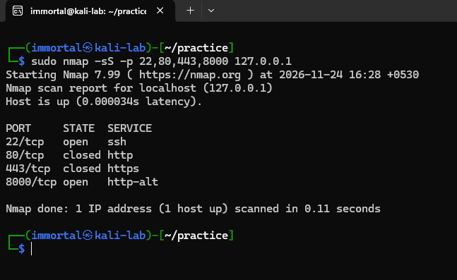
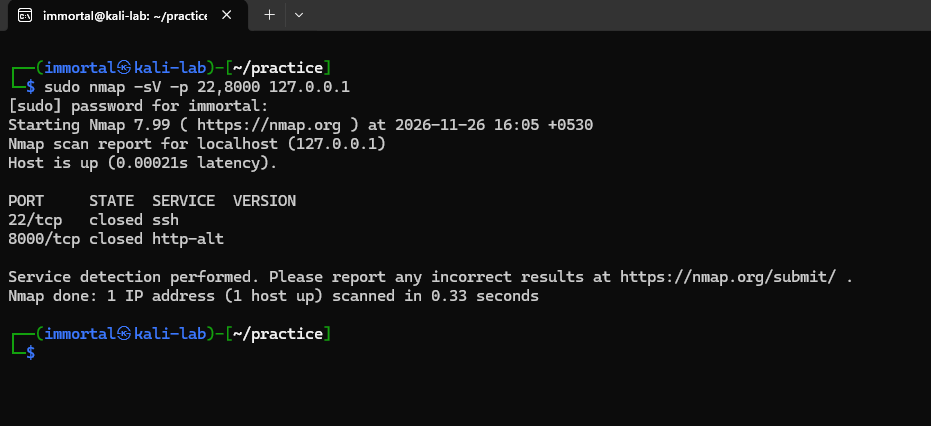
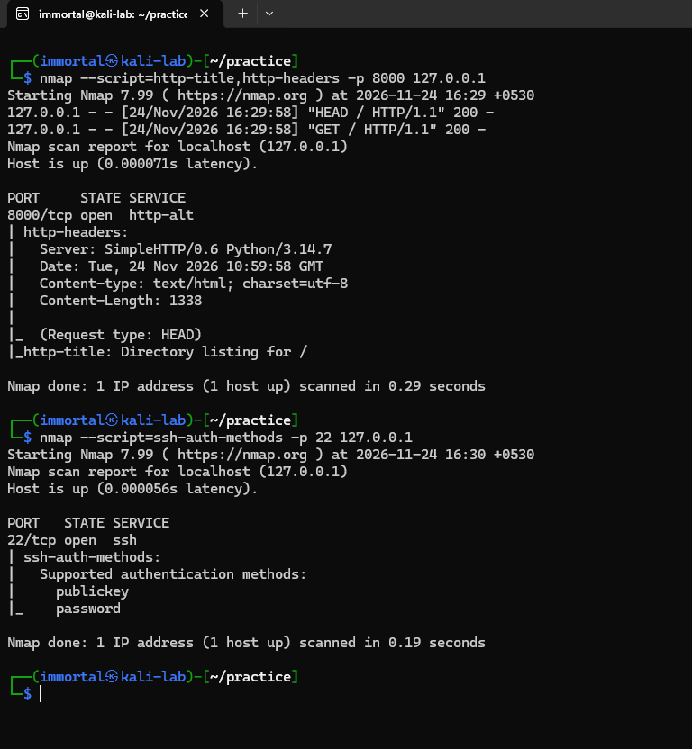
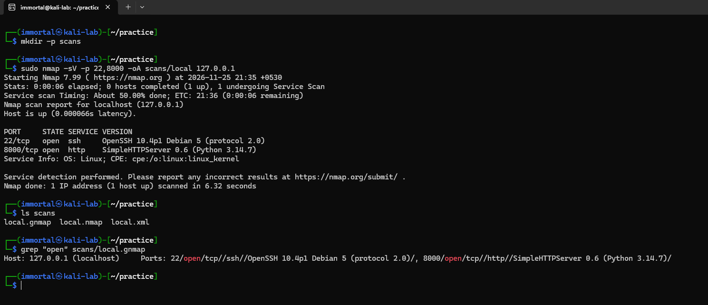

# Port Scanning with Nmap

[Back to networking index](README.md)

Nmap (Network Mapper) is the standard tool for discovering hosts, open ports, running services, operating systems and known weaknesses. It is the first tool most ethical hackers run during reconnaissance. I only scan my own lab machines, or targets I have written permission to test. `scanme.nmap.org` is Nmap's official test host, and I send it only a few requests.

I practiced on Kali Linux in WSL2, against my own machine (`127.0.0.1`), with the SSH server and a Python web server as targets. Nmap may need installing first: `sudo apt install nmap -y`.

## Basic syntax

```
nmap [scan type] [options] <target>
```

Ways to give a target:

```
nmap 192.168.1.10                              # single IP
nmap scanme.nmap.org                           # hostname
nmap 192.168.1.0/24                            # whole subnet
nmap 192.168.1.1-50                            # range
nmap -iL targets.txt                           # targets from a file
nmap 192.168.1.0/24 --exclude 192.168.1.1      # skip one address
```

## Host discovery

```
nmap -sn 192.168.1.0/24      # ping sweep only, no port scan (list live hosts)
nmap -Pn 192.168.1.10        # skip discovery, assume the host is up (when ICMP is blocked)
nmap -PR 192.168.1.0/24      # ARP discovery (default and most reliable on a LAN)
nmap -sL 192.168.1.0/29      # just list targets, send nothing
```

## Specifying ports

```
nmap 192.168.1.10                 # default: top 1000 TCP ports
nmap -p 22,80,443 192.168.1.10    # specific ports
nmap -p 1-1024 192.168.1.10       # range
nmap -p- 192.168.1.10             # all 65535 ports
nmap -F 192.168.1.10              # fast: top 100 ports
nmap --top-ports 20 192.168.1.10
sudo nmap -sU -sS -p U:53,161,T:21-25,80 192.168.1.10   # mixed UDP and TCP
```

For a mixed UDP and TCP list, I need to ask for both scan types (`-sU` and `-sS`).

## Scan types

### SYN scan: `-sS` (the default as root, also called "stealth" or "half-open")

Nmap sends a SYN. If it gets SYN+ACK, the port is open, and Nmap then sends RST instead of ACK, so the handshake is never completed. It is fast and is less likely to be logged by the application.

```
Open port:      Nmap --SYN-->  Target
                Nmap <-SYN/ACK- Target
                Nmap --RST-->  Target     (connection never completes)

Closed port:    Nmap --SYN-->  Target
                Nmap <---RST--- Target

Filtered port:  Nmap --SYN-->  (no reply, or ICMP unreachable)
```

```
sudo nmap -sS 192.168.1.10
```

### TCP connect scan: `-sT` (the default without root)

It uses the operating system's full `connect()` call and completes the three-way handshake, so it is slower and gets logged more easily.

```
nmap -sT 192.168.1.10
```

### UDP scan: `-sU`

It is slow, because UDP services often don't reply. No reply gives `open|filtered`, and an ICMP port-unreachable gives `closed`. Always limit the port range.

```
sudo nmap -sU --top-ports 20 192.168.1.10
sudo nmap -sU -p 53,67,69,123,161 192.168.1.10
```

### Other scan types (know they exist)

| Option | Name | Idea |
|---|---|---|
| `-sA` | ACK scan | Maps firewall rules: reports filtered or unfiltered |
| `-sF`, `-sN`, `-sX` | FIN, Null, Xmas | Odd flag combinations. Closed ports reply RST and open ports stay silent (works on RFC-compliant systems, not Windows). |
| `-sW` | Window scan | Like ACK, but inspects the TCP window size |
| `-sI` | Idle (zombie) scan | Scans via a third host, hiding my IP |
| `-sn` | Ping scan | Host discovery only |

## Service and version detection: `-sV`

Open port numbers only **suggest** a service. `-sV` connects to each open port, reads the banner and sends probes to identify the real software and version. Versions let me search for known vulnerabilities (CVEs).

```
sudo nmap -sV 192.168.1.10
sudo nmap -sV --version-intensity 9 192.168.1.10   # try harder (0 to 9)
sudo nmap -sV --version-light 192.168.1.10         # faster, less accurate
```

Example output from a Metasploitable 2 lab (a reference example, not my own scan):

```
PORT     STATE SERVICE     VERSION
21/tcp   open  ftp         vsftpd 2.3.4
22/tcp   open  ssh         OpenSSH 4.7p1 Debian 8ubuntu1 (protocol 2.0)
23/tcp   open  telnet      Linux telnetd
25/tcp   open  smtp        Postfix smtpd
80/tcp   open  http        Apache httpd 2.2.8 ((Ubuntu) DAV/2)
139/tcp  open  netbios-ssn Samba smbd 3.X - 4.X
445/tcp  open  netbios-ssn Samba smbd 3.X - 4.X
3306/tcp open  mysql       MySQL 5.0.51a-3ubuntu5
```

How to read it: `vsftpd 2.3.4` is a famous backdoored release, and Apache 2.2.8 and OpenSSH 4.7 are very old. These are leads for the next phase, such as running `searchsploit vsftpd 2.3.4` or checking the CVE databases.

## OS detection: `-O`

Nmap sends specially crafted probes and compares how the TCP/IP stack responds (TTL, window size, options, flags) with a fingerprint database. It needs root and at least one open and one closed port to be accurate.

```
sudo nmap -O 192.168.1.10
sudo nmap -O --osscan-guess 192.168.1.10   # show best guesses
sudo nmap -A 192.168.1.10                  # aggressive: -sV -O -sC --traceroute
```

Sample output:

```
Device type: general purpose
Running: Linux 2.6.X
OS CPE: cpe:/o:linux:linux_kernel:2.6
OS details: Linux 2.6.9 - 2.6.33
Network Distance: 1 hop
```

Results are estimates, and firewalls, VMs and NAT can distort them.

## Nmap Scripting Engine (NSE): `--script`

NSE runs Lua scripts for discovery, brute force, vulnerability checks and more. Scripts live in `/usr/share/nmap/scripts/`. They are grouped into categories: `default`, `safe`, `discovery`, `version`, `vuln`, `auth`, `brute`, `exploit`, `intrusive`, `malware`. Categories like `brute`, `exploit` and `intrusive` can disrupt or damage a target, so I only run them on my own lab machines.

```
nmap -sC 192.168.1.10                              # run default scripts (same as --script=default)
nmap --script=vuln 192.168.1.10                    # known-vulnerability checks
nmap --script=http-title,http-headers -p 80 192.168.1.10
nmap --script=ftp-anon -p 21 192.168.1.10          # is anonymous FTP allowed?
nmap --script=smb-os-discovery -p 445 192.168.1.10
nmap --script=ssh-auth-methods -p 22 192.168.1.10
nmap --script=dns-zone-transfer -p 53 --script-args dns-zone-transfer.domain=example.com ns1.example.com
nmap --script "http-*" -p 80 192.168.1.10          # wildcard
nmap --script-help ftp-anon                        # read the documentation
ls /usr/share/nmap/scripts | grep smb              # find scripts
sudo nmap --script-updatedb                        # refresh the script index
```

Example output:

```
PORT   STATE SERVICE
21/tcp open  ftp
| ftp-anon: Anonymous FTP login allowed (FTP code 230)
|_drwxr-xr-x   2 ftp   ftp   4096 Mar 01  2024 pub
```

## Output formats: `-oN`, `-oX`, `-oG`, `-oA`

| Option | Format | Best for |
|---|---|---|
| `-oN file.txt` | Normal text | Reading and reports |
| `-oX file.xml` | XML | Importing into tools (Metasploit, Zenmap, parsers) |
| `-oG file.gnmap` | Grepable | Quick filtering with grep or awk (deprecated but handy) |
| `-oA basename` | All three at once | Best habit: creates `.nmap`, `.xml` and `.gnmap` |
| `-oS file` | Script kiddie | Just for fun |

Create the output folder first, then scan and filter the results:

```
mkdir scans
sudo nmap -sV -oA scans/metasploitable 192.168.56.101
grep "open" scans/metasploitable.gnmap

# list only hosts with port 22 open
grep "22/open" scans/metasploitable.gnmap | cut -d' ' -f2

# convert XML to an HTML report (install first: sudo apt install xsltproc)
xsltproc scans/metasploitable.xml -o scans/report.html
```

## Timing, verbosity and evasion basics

| Option | Purpose |
|---|---|
| `-T0` to `-T5` | Timing template: 0 paranoid (very slow), 3 normal (default), 4 aggressive, 5 insane. Use `-T4` in labs. |
| `-v` / `-vv` | Verbose: show open ports as they are found |
| `-d` | Debug output |
| `--reason` | Explain why each port has its state |
| `--open` | Show only open ports |
| `--packet-trace` | Show every packet sent and received |
| `-D RND:5` | Decoy scan, mixes my IP among fake sources |
| `-f` | Fragment packets (older firewalls) |
| `--source-port 53` | Spoof the source port (may bypass poorly written rules) |
| `--min-rate 1000` | Send at least 1000 packets per second |

Evasion options are for understanding how firewalls and IDS behave in my own lab. I don't use them against systems I don't have permission to test.

## Practical lab: scan my own machine step by step

**Setup:** I scan only my own machine, using `127.0.0.1`, with two services as targets: the SSH server and a Python web server bound to the loopback address.

```bash
sudo apt install nmap -y
sudo service ssh start
cd ~/practice
python3 -m http.server 8000 --bind 127.0.0.1 > /dev/null 2>&1 &
```

I send the web server's log to `/dev/null`. Otherwise it prints a line into my terminal for every request, and those lines get mixed into the Nmap output.

A bigger lab would use Metasploitable 2 on a VirtualBox host-only network: log in with the default credentials of that lab VM, find its address with `ifconfig`, and use that address instead of `127.0.0.1`. I did not use it here.

### 1. SYN scan

```bash
sudo nmap -sS -p 22,80,443,8000 127.0.0.1
```



- `-sS` sent a SYN to each of the four ports without completing the handshake, and `-p` limited the scan to those ports.
- Port 22 (the SSH server) and port 8000 (the Python web server) were listed as `open`.
- Ports 80 and 443 were listed as `closed`: nothing listens there, so the machine answered my SYN with a RST. Nmap lists every port when I scan only a few. On a larger scan, it hides the closed ports and prints a line such as "Not shown: 98 closed tcp ports (reset)".
- The output also shows that the host is up, with its latency, and how long the scan took.

### 2. Service and version detection

```bash
sudo nmap -sV -p 22,8000 127.0.0.1
```



- `-sV` connected to each open port and read the banner, so the `VERSION` column names the real software: OpenSSH for port 22, and a Python HTTP server for port 8000.
- In this screenshot, the web server's own log is mixed into the output, because I ran it without sending its log to `/dev/null`. Those lines are the probes that Nmap sent to identify the service: `GET /`, `POST /sdk`, `GET /nmaplowercheck...`, `GET /HNAP1` and `GET /evox/about`. Version detection works by sending such probes and comparing the answers with a database.
- A version is a lead: the next step would be to look it up in a CVE database. Here the versions come from my own up-to-date system.

### 3. Scripts

```bash
nmap --script=http-title,http-headers -p 8000 127.0.0.1
nmap --script=ssh-auth-methods -p 22 127.0.0.1
```



- `http-title` printed the title of the page the web server returned, `Directory listing for /`.
- `http-headers` printed the response headers (`Server`, `Date`, `Content-type` and `Content-Length`) and the request type it used (`HEAD`). The `Server` header names Python's `SimpleHTTP`, which tells an attacker exactly what software is running.
- `ssh-auth-methods` listed the authentication methods the SSH server accepts. `password` is on the list because my server allows password logins, which attackers can try to brute-force. Keys are safer.

### 4. Saving the output

```bash
mkdir -p scans
sudo nmap -sV -p 22,8000 -oA scans/local 127.0.0.1
ls scans
grep "open" scans/local.gnmap
```



- `-oA scans/local` created three files at once: `local.nmap` (normal text), `local.xml` and `local.gnmap` (grepable).
- `grep "open"` on the grepable file printed one line with the open ports and their services, which is easy to process with other tools.

### 5. Watching the scan on the network

I captured a scan in Wireshark and explained it in [Wireshark captures explained](05-wireshark-captures-explained.md), Capture 7.

### 6. Document the results

For each open port I write the service, the version, the risk and the recommended fix. This is the base of a pentest report.

### Cleaning up

```bash
kill %1
sudo service ssh stop
rm -r scans
```

## Mini report

My own scan found two open ports:

| Port | Service / Version | Risk | Recommendation |
|---|---|---|---|
| 22/tcp | OpenSSH (version from my scan) | Password logins are allowed, so the account can be brute-forced | Use key-based login and disable password login, keep OpenSSH updated, and stop the service when I don't need it |
| 8000/tcp | Python `http.server` | Serves every file in its directory without authentication | Use it only for short transfers, bind it to `127.0.0.1`, and stop it afterwards |

For comparison, here are typical findings on Metasploitable 2, an intentionally vulnerable VM (a reference example, not my own scan):

| Port | Service / Version | Risk | Recommendation |
|---|---|---|---|
| 21/tcp | vsftpd 2.3.4 | Backdoored version; anonymous login possible | Upgrade or replace; disable anonymous access; use SFTP |
| 23/tcp | Linux telnetd | Clear-text credentials | Disable Telnet; use SSH |
| 445/tcp | Samba 3.x | Old SMB, multiple known CVEs | Patch; restrict by firewall |
| 3306/tcp | MySQL 5.0.51a | Database exposed on the network | Bind to localhost; use a firewall |

## Nmap cheat sheet

| Task | Command |
|---|---|
| Live hosts on LAN | `sudo nmap -sn 192.168.1.0/24` |
| Quick top ports | `nmap -F <ip>` |
| Full TCP port scan | `sudo nmap -p- -T4 <ip>` |
| Stealth SYN scan | `sudo nmap -sS <ip>` |
| Versions | `sudo nmap -sV <ip>` |
| OS detection | `sudo nmap -O <ip>` |
| Aggressive all-in-one | `sudo nmap -A -T4 <ip>` |
| Default scripts | `nmap -sC <ip>` |
| Vulnerability scripts | `nmap --script vuln <ip>` |
| UDP scan | `sudo nmap -sU --top-ports 20 <ip>` |
| No ping (firewalled host) | `nmap -Pn <ip>` |
| Save everything | `nmap -oA name <ip>` |
| Typical first scan in practice | `sudo nmap -sC -sV -T4 -oA first <ip>` |