# Windows Basics

[Back to Foundations](README.md)

My notes on Windows for security work: the shells, users and permissions, the registry, processes and services, networking and event logs. For educational use only.

## Where I learned this

- Microsoft Learn (free documentation)
- TryHackMe Windows Fundamentals rooms (some are premium, so check for the lock icon first)
- My own practice on Windows 11

## Lab rules

- Commands that only read information can run any time.
- Commands that change the system use harmless test objects that I clean up afterwards: the folder `C:\Lab`, the user `labuser`, the registry key `HKCU\Software\LabTest` and the task `LabTask`. The cleanup commands are at the end of this file.
- I use an elevated window (Windows Terminal as administrator) only where a section says so.
- I cover my Windows user name in screenshots.

## 1. Command Prompt and PowerShell

Windows has two command-line shells:

- **Command Prompt (`cmd.exe`):** the old shell, with text commands such as `dir` and `type`.
- **PowerShell:** the modern shell. Its commands (cmdlets) follow a **Verb-Noun** pattern, such as `Get-Process`, and they pass **objects**, not just text, through the pipeline. It is the main tool for Windows administration.

| Task | Command Prompt | PowerShell |
|---|---|---|
| List files | `dir` | `Get-ChildItem` (alias `ls`) |
| Change directory | `cd` | `Set-Location` (alias `cd`) |
| Print a file | `type` | `Get-Content` (alias `cat`) |
| Search text | `findstr` | `Select-String` |
| Processes | `tasklist` | `Get-Process` |
| Help | `help` | `Get-Help <cmdlet> -Examples` |

```powershell
$PSVersionTable.PSVersion
Get-Command *service* | Select-Object -First 5 Name, CommandType
Get-Process | Sort-Object WorkingSet -Descending | Select-Object -First 5 Name, Id, WorkingSet
Select-String -Path C:\Windows\System32\drivers\etc\hosts -Pattern "localhost"
```

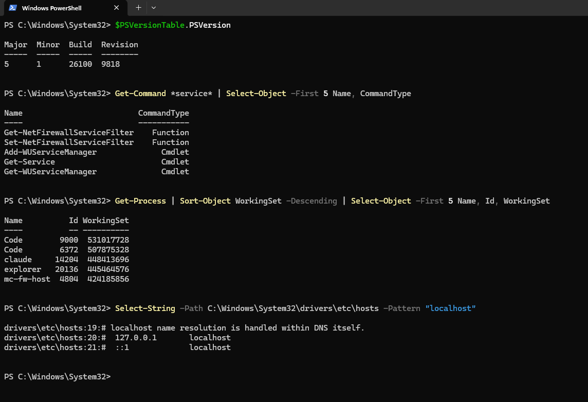

- `$PSVersionTable.PSVersion` shows which version of PowerShell I am using.
- `Get-Command *service*` searched for cmdlets by part of a name. The Verb-Noun pattern makes them easy to guess (`Get-Service`, `Stop-Service`).
- The pipeline passed **objects**: `Sort-Object WorkingSet` sorted real numbers (memory use), and `Select-Object` picked the columns and the first 5 rows.
- `Select-String` searched the `hosts` file for a pattern, like `grep` on Linux. It printed the file name, the line number and the matching line. The `hosts` file maps names to addresses and is read before DNS (in a default file, the `localhost` lines are comments).

## 2. Users, groups and UAC

Windows has built-in accounts (`Administrator`, `Guest`, `SYSTEM`) and groups (`Administrators`, `Users`, `Remote Desktop Users`). Every user and group has a **SID** (Security Identifier), which Windows uses internally instead of names. The number at the end of a SID is the **RID**: `500` is the built-in Administrator, and normal accounts start at `1000`.

**UAC (User Account Control)** gives an administrator account two tokens. Programs normally run with a **standard** token. Only after I approve a prompt does a program get the **full** administrator token (an elevated process).

```
whoami /groups        shows my groups, SIDs and integrity level
whoami /priv          shows my privileges
net user              lists the local users
net localgroup Administrators   lists the administrators
```

```powershell
Get-LocalUser
Get-LocalGroupMember -Group "Administrators"
```

These commands print my own account name, so I cover it in screenshots. I looked at my groups and privileges in a normal window:

```powershell
whoami /groups | Select-Object -First 20
whoami /priv | Select-Object -First 12
```

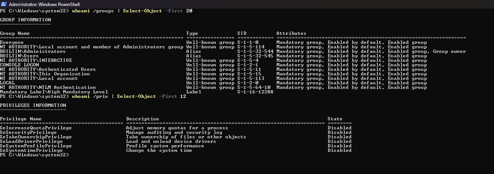

- `whoami /groups` lists the groups in my token, such as `Everyone` and `BUILTIN\Users`. In a normal window, an administrator account shows `BUILTIN\Administrators` as **"Group used for deny only"**. That is UAC at work: the group does not give me administrator rights until I elevate.
- `NT AUTHORITY\Local account and member of Administrators group` is shown the same way, because it also comes from my administrator membership.
- The `Mandatory Label` entry at the end of the list is my integrity level: Medium in a normal window, High in an elevated one.
- `whoami /priv` lists my privileges and whether each is `Enabled` or `Disabled`. A normal window has only a few. An elevated window shows many more, which matter in privilege escalation.

I created a test user, looked at it, and deleted it (elevated window):

```
net user labuser * /add
net user labuser
net user labuser /delete
```

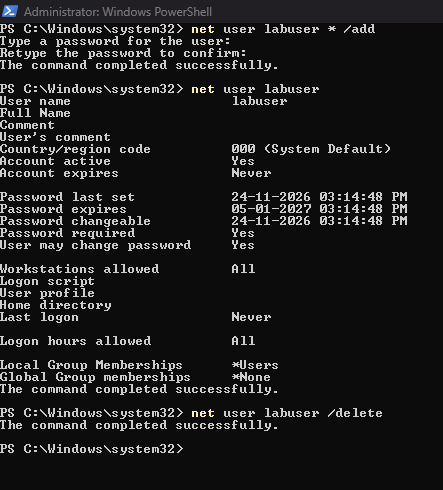

- The `*` made Windows ask for the password, so it is not typed in plain text or saved in my command history. The password is not shown while I type.
- `net user labuser` showed the account details: `Account active : Yes`, when the password was set, and `Local Group Memberships : *Users`. A new account is only a normal user.
- `net user labuser /delete` removed the account again.

## 3. NTFS permissions and shares

NTFS is the default Windows file system. Each file and folder has an **ACL** (Access Control List) with entries (ACEs) that say who may do what:

| Letter in `icacls` | Permission |
|---|---|
| `F` | Full control |
| `M` | Modify |
| `RX` | Read and execute |
| `R` | Read |
| `W` | Write |

- **Inheritance:** a file normally inherits its permissions from its parent folder. `(I)` in the output means inherited.
- **Deny beats allow:** an explicit deny overrides an allow.
- **Share vs NTFS permissions:** when a file is reached over a network share, Windows applies both sets, and the stricter one wins.

```
icacls <file>                      view the permissions
icacls <file> /grant Everyone:R    give Everyone read access
icacls <file> /remove Everyone     remove that entry
net share                          list shares (C$, ADMIN$ and IPC$ exist by default)
```

I looked at the permissions of a test file, added an entry and removed it again (Command Prompt or PowerShell):

```
mkdir C:\Lab\perm-test
echo secret > C:\Lab\perm-test\secret.txt
icacls C:\Lab\perm-test\secret.txt
icacls C:\Lab\perm-test\secret.txt /grant "Everyone:R"
icacls C:\Lab\perm-test\secret.txt
icacls C:\Lab\perm-test\secret.txt /remove "Everyone"
icacls C:\Lab\perm-test\secret.txt
```

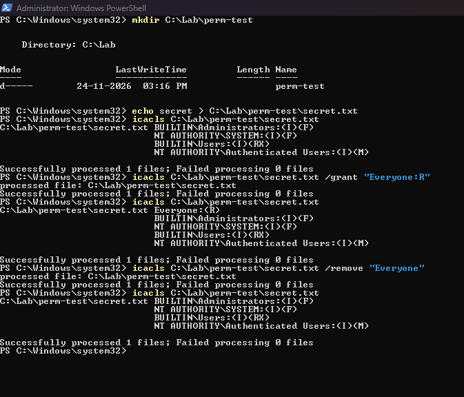

- Each line has the form `NAME:(flags)`. `(I)` means the entry is inherited from the folder above, and `(F)` or `(RX)` is the permission.
- After `/grant "Everyone:R"`, a new line `Everyone:(R)` appeared. It has no `(I)`, because I added it directly to the file and it was not inherited. After `/remove "Everyone"`, it was gone again.
- Every `icacls` call ends with `Successfully processed 1 files`.

NTFS files can also have hidden extra data streams (**alternate data streams**, or ADS). Attackers sometimes hide data in them, so defenders need to know about them (Command Prompt, because `dir /r` is a `cmd` option):

```
echo visible > C:\Lab\ads.txt
echo hidden-data > C:\Lab\ads.txt:secret
type C:\Lab\ads.txt
dir /r C:\Lab\ads.txt
more < C:\Lab\ads.txt:secret
```

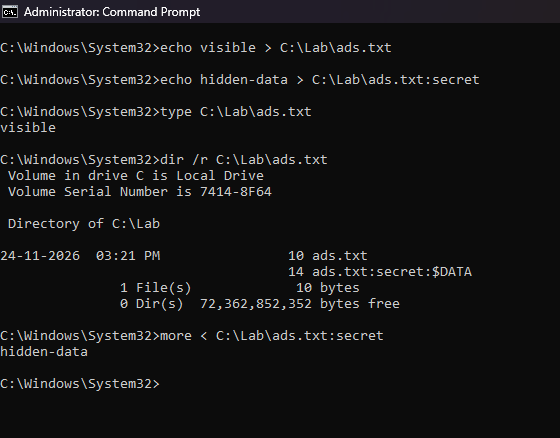

- `type` showed only the visible text, and the file size did not include the hidden stream.
- `dir /r` listed the extra stream `ads.txt:secret:$DATA`, and `more < ads.txt:secret` printed the hidden text.
- Normal file listings don't show a stream, which is why it can hide data.

## 4. The registry

The registry is a database where Windows and programs store settings. It is made of **keys** (like folders) and **values** (like files in a folder).

| Hive | Short | What it holds |
|---|---|---|
| `HKEY_LOCAL_MACHINE` | `HKLM` | Settings for the whole machine |
| `HKEY_CURRENT_USER` | `HKCU` | Settings for the logged-in user |
| `HKEY_CLASSES_ROOT` | `HKCR` | File associations |
| `HKEY_USERS` | `HKU` | Settings for all loaded profiles |

| Value type | Meaning |
|---|---|
| `REG_SZ` | A string |
| `REG_DWORD` | A 32-bit number (often 0 or 1) |
| `REG_BINARY` | Raw bytes |
| `REG_MULTI_SZ` | A list of strings |
| `REG_EXPAND_SZ` | A string with variables such as `%SystemRoot%` |

The `Run` keys (`HKCU\Software\Microsoft\Windows\CurrentVersion\Run` and the `HKLM` version) start programs at logon, so they are a common place for **persistence**. Defenders check them for entries that should not be there.

I read a value, created a test key with two values, read it and deleted it (Command Prompt):

```
reg query "HKLM\SOFTWARE\Microsoft\Windows NT\CurrentVersion" /v ProductName
reg add HKCU\Software\LabTest /v Greeting /t REG_SZ /d "hello"
reg add HKCU\Software\LabTest /v Counter /t REG_DWORD /d 5
reg query HKCU\Software\LabTest
reg delete HKCU\Software\LabTest /f
reg query HKCU\Software\LabTest
```

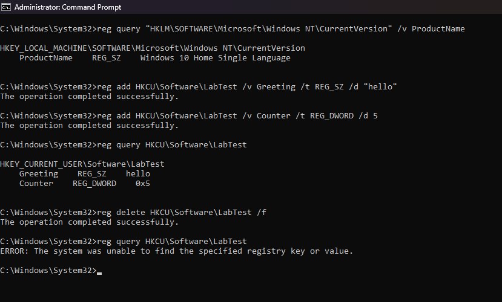

- The first command read one value under `HKLM` and printed the name of my Windows edition. It says "Windows 10", even though I run Windows 11, because Microsoft kept the old product name in this value for compatibility. The build number (26100, which also appears in PowerShell's version) is what identifies Windows 11 24H2.
- The two `reg add` commands created the key `LabTest` with a string and a number. `reg query` showed them with their types, and the number was shown in hex as `0x5`.
- After `reg delete`, the last `reg query` printed an error saying the key could not be found, which proves it was removed.
- I always create test keys under `HKCU`, because they affect only my user and are easy to delete.

## 5. Processes, services and scheduled tasks

A **process** is a running program. A **service** is a program that runs in the background, often from boot, as a chosen account (`LocalSystem`, `LocalService`, `NetworkService` or a user). A **scheduled task** runs a program at a set time or event, like cron on Linux.

| Process | What it is |
|---|---|
| `System` | The kernel (PID 4) |
| `services.exe` | The Service Control Manager, parent of service processes |
| `svchost.exe` | Hosts many services. Several copies are normal. |
| `lsass.exe` | Handles logons and holds security data. There should be one. |
| `explorer.exe` | The desktop and taskbar |

Malware often masquerades under these names (for example `scvhost.exe`), so I check the **spelling**, the **folder**, the **parent process** and the **user**.

```powershell
Start-Process notepad
Get-Process notepad
tasklist /fi "imagename eq notepad.exe"
Stop-Process -Name notepad
Get-Process notepad
```

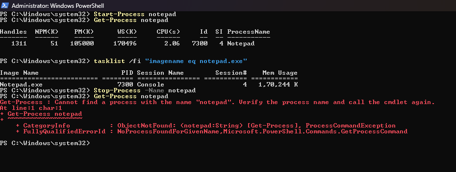

- `Start-Process notepad` started the program, and `Get-Process notepad` and `tasklist` both found it, with its process ID.
- `Stop-Process -Name notepad` ended it. The last `Get-Process` printed an error that no process with that name exists, which confirms that it stopped.

```powershell
Get-Service -Name Spooler
Get-CimInstance Win32_Service -Filter "Name='Spooler'" | Select-Object Name, State, StartMode, StartName, PathName
tasklist /svc /fi "imagename eq svchost.exe" | Select-Object -First 8
```

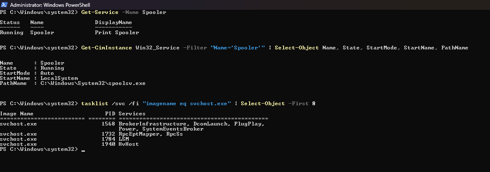

- `Get-Service` showed whether the Print Spooler service is running. The CIM query added how it starts (`StartMode`), the account it runs as (`StartName`, normally `LocalSystem`) and the program it runs (`PathName`).
- `tasklist /svc` listed several `svchost.exe` processes and the services inside each. Many services share one `svchost.exe`, which is why a single image name appears many times.
- A service that runs as `LocalSystem` and has a weak configuration (a path a normal user can change, or an unquoted path with spaces) can lead to privilege escalation. I will study that later.

I created a scheduled task, ran it, read its output and deleted it:

```powershell
schtasks /create /tn "LabTask" /tr "cmd.exe /c echo hello >> C:\Lab\task.log" /sc minute /mo 5
schtasks /query /tn "LabTask"
schtasks /run /tn "LabTask"
Start-Sleep -Seconds 10
schtasks /query /tn "LabTask" /v /fo list | Select-String "Last Run Time|Last Result"
Get-Content C:\Lab\task.log
schtasks /delete /tn "LabTask" /f
```

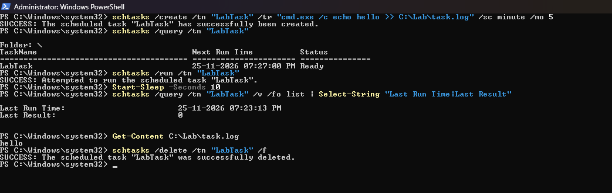

- `schtasks /create` printed `SUCCESS`, and `/query` showed the task with its next run time and status `Ready`.
- `/run` started it at once. After 10 seconds, `Last Result : 0` means that the task finished successfully, and `Get-Content` showed `hello` in the log file, which proves that the task ran.
- Tasks created with `schtasks` do not start on a laptop that runs on battery by default. In that case `Last Result` is `0x800710E0` and the log file is never created, so I plug in the charger for this exercise.
- `/delete` removed the task. Programs can also start automatically from the `Run` registry keys, services and the Startup folders, so I check all of them when I look for persistence.

## 6. Networking

The Windows tools match the Linux ones: `ipconfig` is `ip a`, `netstat -ano` is `ss -tulpn`, `tracert` is `traceroute`, and `Test-NetConnection` is similar to `nc -vz`. See also my [networking notes](02-networking/README.md).

```powershell
ipconfig | Select-String "IPv4|Default Gateway"
Get-NetTCPConnection -State Listen -LocalPort 135 | Select-Object LocalAddress, LocalPort, OwningProcess
Get-Process -Id (Get-NetTCPConnection -State Listen -LocalPort 135 | Select-Object -First 1).OwningProcess
Test-NetConnection -ComputerName scanme.nmap.org -Port 80
netsh advfirewall show allprofiles | Select-String "Profile|State"
```

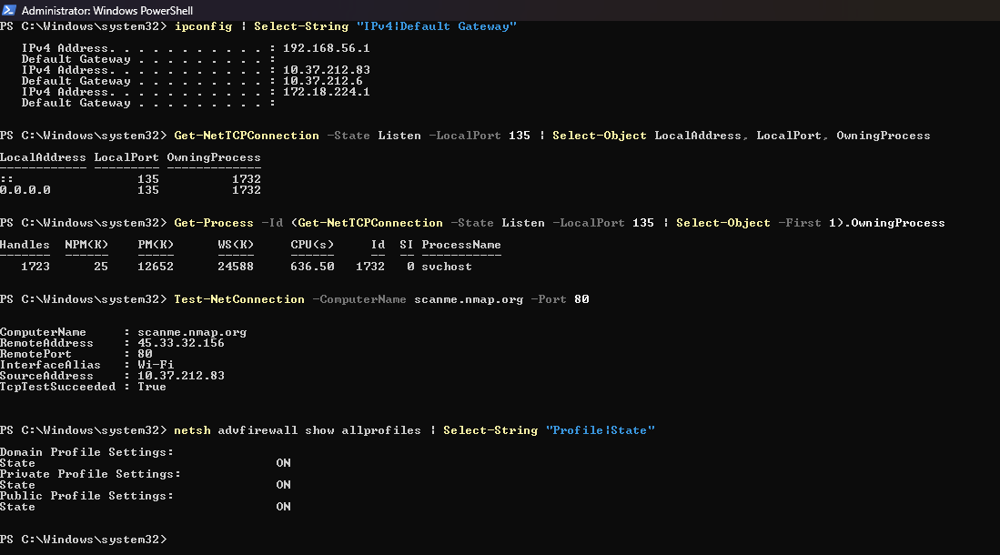

- The first command printed one IPv4 address for each network adapter. Only the Wi-Fi adapter has a **Default Gateway**, which is how it reaches the Internet. The other addresses belong to virtual adapters (such as the ones for WSL and VirtualBox), and they have no gateway. `ipconfig` without the filter shows which adapter each address belongs to.
- `Get-NetTCPConnection` showed port 135 (the RPC endpoint mapper) in the `Listen` state with the ID of the process that owns it. `Get-Process` turned that ID into a name, which is `svchost`.
- `Test-NetConnection` tested a TCP connection to port 80 on Nmap's official test host (`TcpTestSucceeded : True` means it worked). It also showed which interface and source address I used.
- The firewall has three profiles, **Domain**, **Private** and **Public**, and each one showed `State ON`. A new network normally gets the strictest profile, Public.

## 7. Event logs

Windows records what happens in **event logs**. As a defender I read them to find attacks. The main logs are **Security** (logons and account changes, needs administrator rights), **System** and **Application**. Event Viewer opens with `eventvwr.msc`.

| Event ID | Meaning | What I did to cause it |
|---|---|---|
| 4720 | A user account was created | `net user labuser * /add` |
| 4625 | An account failed to log on | `runas /user:labuser cmd` with a wrong password |
| 4726 | A user account was deleted | `net user labuser /delete` |

Other events that matter: `4624` (successful logon), `4672` (an administrator logged on), `4688` (a process was created, needs auditing), `4698` (a scheduled task was created), `7045` (a service was installed) and `1102` (the audit log was cleared, which is suspicious).

| Logon type | Meaning |
|---|---|
| 2 | Interactive (at the keyboard) |
| 3 | Network (for example a share) |
| 4 | Batch (scheduled task) |
| 5 | Service |
| 10 | RemoteInteractive (RDP) |

I caused the three events in the table, and then read them from the Security log (elevated window). In `runas`, I typed a wrong password on purpose:

```powershell
net user labuser * /add
runas /user:labuser cmd
net user labuser /delete
Get-WinEvent -FilterHashtable @{LogName='Security'; Id=4720,4625,4726} -MaxEvents 6 |
  Select-Object TimeCreated, Id, @{n='Account';e={ if ($_.Id -eq 4625) { $_.Properties[5].Value } else { $_.Properties[0].Value } }}
```

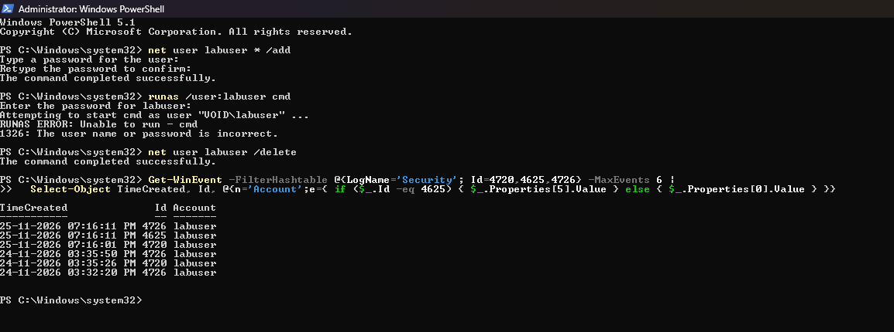

- `runas` printed an error that the user name or password is incorrect. That failed logon is what created event `4625`.
- The newest event is at the top: `4726` (deleted), then `4625` (failed logon), then `4720` (created), all for the account `labuser`.
- Together they tell a story that a defender could read: an account was created, someone failed to log in to it, and the account was removed. Real attacks leave similar traces.
- If an event does not appear, auditing may be off. I enable it with `auditpol /set /subcategory:"Logon" /success:enable /failure:enable` and `auditpol /set /subcategory:"User Account Management" /success:enable`.

## 8. Active Directory concepts

- **Domain:** a group of computers and users managed together, for example `company.local`.
- **Domain controller (DC):** a server that stores the directory and handles logons for the domain.
- **Kerberos:** the default authentication protocol in a domain. It proves identity with tickets, so the password is not sent.
- **NTLM:** an older authentication protocol that is still used as a fallback.
- **Group Policy (GPO):** settings that are pushed to many computers at once.
- **Workgroup vs domain:** in a workgroup, each computer stores its own accounts. In a domain, accounts live centrally on the domain controller.

## 9. Windows vs Linux

| Task | Windows | Linux |
|---|---|---|
| Who am I | `whoami` | `whoami` |
| My groups | `whoami /groups` | `groups` or `id` |
| List users | `net user` | `cat /etc/passwd` |
| List files | `dir` / `Get-ChildItem` | `ls` |
| File permissions | `icacls file` | `ls -l file` |
| Processes | `tasklist` / `Get-Process` | `ps aux` |
| Kill a process | `taskkill` / `Stop-Process` | `kill` |
| Services | `Get-Service` / `sc query` | `systemctl list-units` |
| Scheduled tasks | `schtasks` | `crontab -l` |
| Logs | Event Viewer, `Get-WinEvent` | `/var/log`, `journalctl` |
| Open ports | `netstat -ano` | `ss -tulpn` |
| Settings | The registry | Files in `/etc` |
| Path separator | `\` | `/` |
| Case-sensitive names | No | Yes |
| Most powerful account | `SYSTEM` | `root` |

## Cleaning up

In an elevated Command Prompt, after the exercises:

```
net user labuser /delete
schtasks /delete /tn "LabTask" /f
reg delete HKCU\Software\LabTest /f
rmdir /s /q C:\Lab
```

Commands for things that no longer exist print an error, which is fine.

## Key takeaways

- PowerShell passes objects, so I can sort and filter results directly, and Command Prompt only handles text.
- UAC means that an administrator account runs with a limited token until I elevate, and `whoami /groups` shows which one I have.
- Permissions, the registry, services, scheduled tasks and the `Run` keys are the same places where attackers hide, so a defender checks all of them.
- The Security event log records what I did, so I can read my own actions the way a defender would..